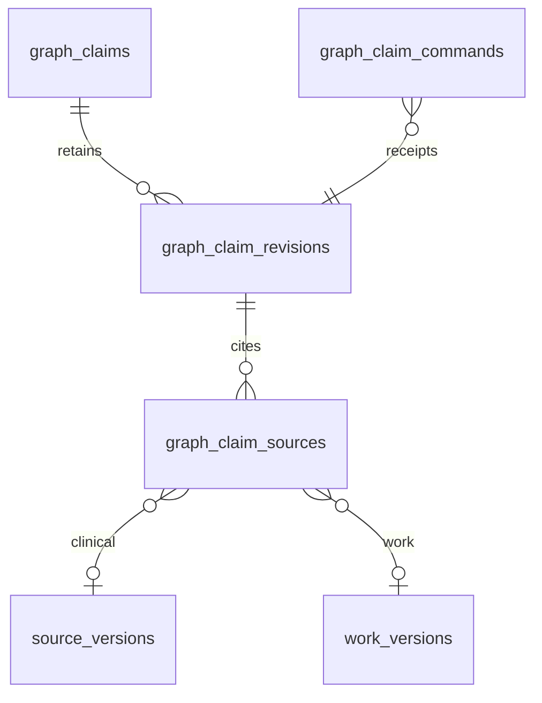

# P09-F01 architecture, contracts and operations

## Data and authority
Schema 58 adds graph_claims, graph_claim_revisions, graph_claim_sources and graph_claim_commands. All are append-only. A header binds organization/facility/patient/owner/purpose/coverage. Revisions bind human author, null model metadata, type, text, unverified state, dates, capture hash, count and payload checksum. Edges cite exact clinical/work immutable ledger IDs, kind, record ID, version, content SHA-256 and recorded time. No source snapshot values are copied into citation rows. Existing legacy evidence tables remain intact.

The GET/POST sourceHash is an organization/facility/patient/owner/purpose/coverage-bound source-context fingerprint. It prevents a page loaded for one principal from issuing a command after a principal change. Each citation's sha256 remains the actual exact source-content checksum. Stored revision source_hash records the underlying inventory capture hash. All reads compare cited pointers with current authorized inventory; matching pointers do not clinically verify free text. Changed/missing pointers withhold dependent text and edges. A changed permission coverage hides the previous context, including specific-ID/history reads.

## HTTP contract v1
GET /api/evidence/claims requires patient; optional claim, revision (1..100, requires claim) and sourceQuery (0..80 characters). Duplicate/unknown parameters are invalid. Browser cookie authority is resolved live by Foundation; origin checks apply. Returns contractVersion, patientId, ownerId, scoped sourceHash, coverage, checkedAt, types, up to 100 current-owner claims and 50 matching source choices plus sourceCount. Read errors never return old content.

POST same route accepts only application/json, bounded valid UTF-8 at 16 KB. Exact fields: patient, commandKey (8..80 safe characters), expectedVersion (0 for create; 1..99 for append), optional claim UUID, type (source-assertion / hypothesis / care-gap-question / risk-question), text (1..2000 characters), sources (0..12 unique current fact hashes), and sourceHash from the authorized GET. No caller author/model/evidence-state fields. Request field ordering does not change idempotency. Same scoped key with changed content conflicts. Returns claim, current context fingerprint and replayed. Atomic PHI-safe outbox event evidence.graph.revised has contractVersion, org/facility/patient, claim/revision IDs, version and evidenceState only.

401: sign in. 403: origin or care permission denied. 404: unavailable claim in current scope. 409: stale source/version or conflicting key. 422: invalid contract/bound. 503: source/integrity/database/audit service unavailable. All responses are no-store with nosniff. Authenticated parser failures receive a generic audit denial without body text. Direct native bearer access is not introduced: the native chart opens the separately authenticated web route with no token in its URL.

## User help
Open a patient chart, choose Evidence claims, select a type and current citations, enter a synthetic draft, and choose Record unverified revision. Find sources filters by record ID, display or code; a draft survives a source search only if the verified source context is unchanged. Clear citations resets the selection. Append revision retains earlier versions; Inspect opens immutable provenance. Source changes withhold old dependent content until a new current revision is recorded. Uncited questions remain unverified, not clinical conclusions. Offline/hidden/access-loss states clear drafts; refresh after recovery. A cancelled or failed response may have committed: refresh rather than replay.

## Operations and rollback
Run npm run evidence:graph:test, npm test, npm run typecheck, npm run lint, native typecheck, optimized Next build and tools/e2e/p09-f01.spec.ts. Retain source/version/audit/outbox/receipt evidence. Rollback removes the navigation/derived workspace; retain a schema-58-compatible backend and do not delete or downgrade retained data. An old schema-57 binary deliberately refuses a schema-58 database. EVIDENCE_GRAPH_FIXTURE_ROLLBACK is disposable-fixture-only. Failed schema migration retains schema 57 and rolls back partial new tables; repair the dependency and retry. PHI-safe audit actions are evidence.graph.access/read/record/denied/invalid-request; source-context fingerprint and IDs provide traceability without logging claim text. The outbox event is derived evidence, not an authoritative clinical-timeline event. No new worker, remote provider, release or automatic clinical action is installed.

## Data handling boundary
These owner-scoped local synthetic drafts are not newly included in external FHIR or DSAR export bundles. Qualified privacy review must classify retention, export and access rights before any real-data deployment; this feature does not authorize production use or change existing export contracts.
