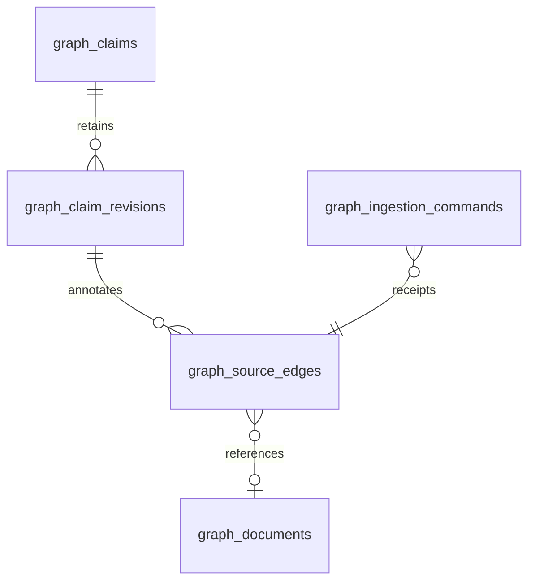

# P09-F02 operations and contract

Local synthetic only; production disabled. Intended use: authorized treatment user annotates a draft claim using exact source versions or owned text-document evidence. Conservative engineering risk C, qualified classification pending. No inference, clinical decision or external communication.

## Data and security
graph_documents: tenant/facility/patient/owner/treatment/coverage, title (160), plain text (8000), nullable effective time, server recorded time, version 1 and scope/content checksum. graph_source_edges: exact claim revision, source format/id/snapshot metadata/checksum and relationship enum supported/contradicting/insufficient. graph_ingestion_commands: scoped receipt and normalized request checksum. All three tables reject updates/deletes. Source tables and previous claim history remain unchanged.

Exact source inspection re-resolves authorized source inventory, checks every persisted metadata field, and returns no content when source or claim revision changed. Document lineage corruption or source outage fails closed. No remote URLs, HTML rendering or bearer credentials in links. Documents with unknown date never receive a fabricated clinical date. Effective and recorded dates are separate. Permissions inherit from patient and source-history access plus exact owner/coverage. Imported documents are not clinical records or qualified medical evidence.

## HTTP v1
GET /api/evidence/sources?patient=ID returns ownerId, patientId, scoped sourceHash, checkedAt, current sources, owned claims, annotated edges and relationship choices. Optional edge=egs_UUID returns an authorized exact inspection instead. Duplicate/unknown parameters are rejected.

POST accepts UTF-8 application/json at most 40 KB. Common fields: patient, commandKey (8–80 safe characters), sourceHash. action=document adds title, content, effectiveAt (UTC instant or null). action=link adds claim, expectedVersion (1–100), format (timeline/fhir-r4/local-document), source and relationship. Unknown fields, verification/model/author overrides and untrusted source IDs are rejected. Reuse of a scoped key is idempotent; changed payload conflicts. Duplicate source/format on a revision conflicts. Bounds: 100 documents per owner/patient/facility, 100 edges per claim; original records are retained.

Responses no-store/nosniff; 401 sign-in, 403 permission/origin, 404 unavailable context, 409 stale/duplicate/key conflict, 422 invalid input, 503 integrity/dependency/audit unavailable. Atomic evidence.source.recorded outbox v1 contains result IDs, actor/patient IDs, action and unverified state only; never document or claim text. Audit evidence.ingestion.read/record/denied/invalid-request contains no input body. Existing audit/outbox monitoring applies; no new provider/queue consumer is installed.

## User help and recovery
Patient chart → Evidence claims → Evidence sources. Import a clearly synthetic plain-text document with known UTC effective time or leave unknown; select a current claim revision, source version and human relationship. Inspect exact evidence shows underlying JSON/document, provenance, checksum and dates. Every claim stays unverified. A new claim revision needs new links. Existing changed links retain their identity but withhold source content.

Loading, failure, cancellation, offline, page hiding, browser restore and source-context drift clear content/drafts. Active views refresh every minute and clear drafts; no browser storage or replay queue is used. A cancelled/unknown write may have committed: refresh before issuing a new command. On 409 review the current source/claim, not blind retry. Restore Foundation/source integrity before retrying 503. Read-only synthetic data must not be used for care.

## Rollback and review
Disable navigation/derived workspace while retaining schema-compatible service and immutable records. Never run disposable EVIDENCE_INGESTION_FIXTURE_ROLLBACK against retained operational data. A 58 binary rejects schema 59; downgrade is not supported. Qualified clinical, privacy, architecture and licensing reviews remain pending. Retention/export classification of local imports is required before real-data use. F03–F05 and formal Phase 09 remain NOT_STARTED.

## Synthetic scenarios
F02-S01 referral document with known date and contradictory annotation → exact content/version/date shown, unverified. F02-S02 missing document date → unknown, never recorded date substituted. F02-S03 alternate tenant/owner or permission revoked → no restricted content. F02-S04 source correction/new claim revision → prior edge content withheld. F02-S05 outbox/database failure → atomic rollback and safe idempotent retry. F02-S06 denied/offline/late browser read → private content cleared, no write replay. No clinical validation is claimed.

## Structural model

A source edge references either current source-ledger metadata or an owned document; exact inspection re-resolves that reference. Document import receipts reference document IDs instead. All data is append-only. The source edge's display state is recomputed as current or changed-or-unavailable; it never changes the claim's unverified evidence state. Clinical source corrections remain source-owned.
