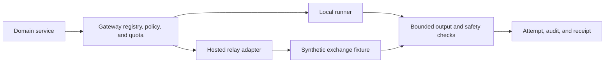

# P10-F01 Provider abstraction

Local synthetic engineering authorized on 2026-11-07. Formal and production reviews are pending.

The gateway checks the local sandbox and active provider/model registration before dispatch. The hosted envelope binds responses to the request trace and versioned model. Schema and phrase checks guard accepted output. The synthetic fixture sends identifier-shaped input to verify that the exchange sees the redacted representation. A relay failure yields the existing unavailable outcome, and invalid output is discarded. The rollback path is to run with the default disabled registry and quota or revert the adapter code while retaining the existing schema and audit history.

The provider adapter swap uses the existing gateway caller and attempt store. The internal adapter contracts live in `packages/domain/src/gateway-provider.ts`. The existing `gateway.attempt` event continues to carry trace and model version. Operator inspection uses the existing Gateway attempt view.

Hosted behavior is verified with a synthetic JSON exchange. Production egress and a real provider connection await approved transport, credential handling, privacy controls, and provider qualification. The static boundary check covers domain and web server business code and the direct egress patterns specified in ESLint. Runtime network policy is a separate control.

## Executed checks

- `node --import tsx --import ./packages/domain/test/dev-env.ts --test packages/domain/test/gateway.test.ts packages/domain/test/agents.test.ts packages/domain/test/evaluation.test.ts` passed all 11 tests. The swap, scope and output checks covered registry denial, redaction, trace binding, replay, invalid response, outage, blocked output and sandbox refusal. Detaching the adapter returned the default no-model refusal.
- `npm run typecheck` passed for contracts, domain, FHIR and web.
- `npm run lint:gateway-boundary` and targeted ESLint for the gateway tests passed. A negative ESLint stdin probe failed as expected for a model SDK import, direct adapter import, direct fetch to a model endpoint, and a dynamic HTTP import.

[Provider boundary decision](../adr/ADR-0088-synthetic-gateway-provider-boundary.md)
