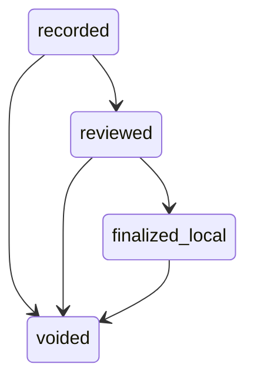
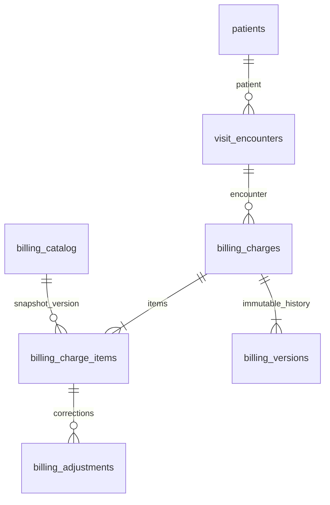

# P04-F05 local contract v1

Intended use: fictional charge recording and clinician workflow evaluation against synthetic source records. Not an invoice, prescription, validated decision support, or payment obligation. No AI dependency. Mobile native integration is outside this feature; the responsive web chart is tested at desktop and 390px widths.

## Boundaries and actors

The existing local chart domain owns the normalized source records and billing tables. PostgreSQL foundation owns workforce sessions. No clinical source table is replaced. Chart aggregates are derived reads. `masterActor` takes identity, organization, facility and session from the authenticated server session, never submitted tenant fields.

Billing officers need an active membership in the charge facility. Clinicians receive only amount-free status. Administrators do not inherit charge access. Auditors can read financial history using their explicit grant. Billing staff cannot record clinical findings or close visits. Existing consent, retention and legal-hold modules remain in place. The synthetic billing retention policy retains records pending human policy approval.

Both new domain surfaces require `CURASPHERE_ENV=local`, `CURASPHERE_DEV_DIRECTORY=local-test`, `CURASPHERE_DATA_CLASS=synthetic`, and `CURASPHERE_LOCAL_PHASE_OVERRIDE=true`. Protected targets, production credentials/databases, real PHI, external healthcare connections, clinical emergency enablement, and publication are denied. This is independent of formal Phase 04 acceptance.

## Transaction interface

Amounts are GHS integer minor units, two decimal digits; the server snapshots catalog price/version and computes totals. Quantity is 1–100. Adjustment amount is 0–10,000,000 minor units. Cross-currency charges are unsupported. Active catalog prices must be effective on the UTC recording date. Record versions and expected versions are positive integers. A mismatch yields a conflict; source history is retained.

| POST route | Form fields | Permission | Successful destination |
| --- | --- | --- | --- |
| `/api/billing/charges` | patientId, encounterId, catalogId, quantity, submissionKey | billing.charge.create | charge detail |
| `/api/billing/charges/{id}/review` | expectedVersion | billing.charge.review | charge detail |
| `/api/billing/charges/{id}/finalize` | expectedVersion | billing.charge.review | charge detail |
| `/api/billing/charges/{id}/adjust` | expectedVersion, itemId, amountMinor, reason | billing.charge.adjust | charge detail |
| `/api/billing/charges/{id}/void` | expectedVersion, reason | billing.charge.void | charge detail |

These HTML form adapters use HTTP 303 redirects. They do not claim JSON 200/409 responses. Domain errors map to the existing error query/message contract: stale version → `source-stale`, forbidden → `forbidden`, validation → its bounded error code, and unexpected failure → generic `invalid` without patient values in logs. Missing or expired sessions redirect to sign-in. Direct domain calls throw the existing typed errors.

Creation returns id, version, status, totalMinor, currency, idempotent. Mutations return id, version, status, idempotent; adjustment also returns totalMinor. The form submission token identifies one intentional creation. The adapter hashes the entire request tuple instead of truncating it. Retried commands are checked against the current charge facility before replay and rechecked under `BEGIN IMMEDIATE`. Reusing a key for a different payload is rejected.

Adjustment reasons: `price-correction`, `quantity-correction`. Void reasons: `entered-in-error`, `no-longer-needed`. Status transitions:

`finalized_local` represents persisted `finalized-local`. No transition transmits a charge, submits a claim, collects payment, or signs a clinical entry.

## Persistence and provenance

Schema 42 creates the billing tables and immutable version triggers. Additive schema 43 guards charge/item amounts and tenant/patient/encounter/catalog links, and prevents adjustment updates/deletes. Existing source rows remain intact. Version snapshots retain actor, facility, encounter, prior version, reason, timestamp and correlation ID. Writes, version history, counters, command results and success audit are transactional. Reads are attributable; denied permissions use the authorization decision ledger.

## Chart states and failure behavior

`/patients/{id}/chart?encounter={id}` verifies the patient before aggregating source modules. All four pending-work queries filter by patient. An encounter from another patient is never rendered. Unknown allergy status is distinct from no known allergies. Blood-pressure components retain display/value/unit; no clinical recommendation is calculated. Observations show effective timestamp and source version. Medication drafts stay non-executable.

Loading uses the route Suspense boundary. Section denial, section failure, absence of records, no selected encounter, superseded identity, and top-level failure are distinct. Partial failures preserve successful source sections and offer reload. Closed encounters continue through the existing server-side clinical-write guards. Financial failures never imply zero owed or successful collection.

Operational counters are stored by tenant/facility and omit patient names, values and amounts. `billingSnapshot(db, actor, {traceId})` requires financial read access and sanitizes trace text. A billing dependency outage rejects new writes; chart clinical sections remain readable. There is no asynchronous consumer/outbox or provider call in these synchronous local billing transactions.
