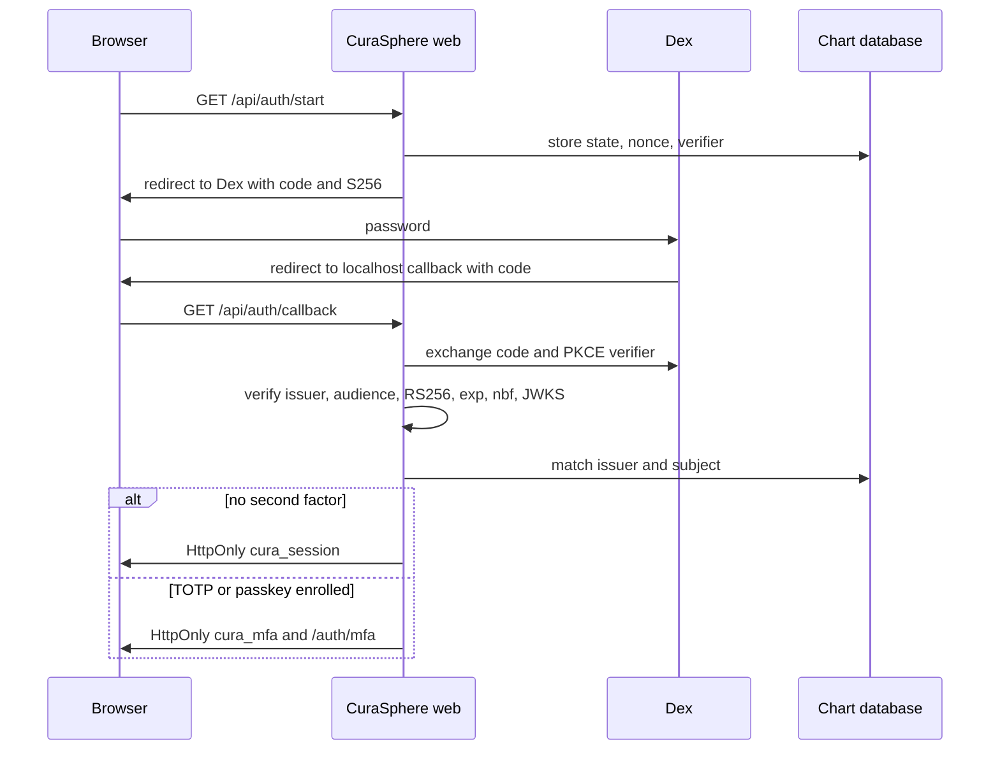

# Workforce authentication

Dex `v2.42.0` is the local identity provider. CuraSphere is the relying party and the session authority. Organization access comes from membership rows, not from Dex claims.

## Responsibilities

Dex checks the password, issues the authorization code, and signs the ID token with RS256. It also issues a refresh token when the scope includes `offline_access`. Its password connector does not enroll MFA or passkeys.

CuraSphere builds the authorization request, stores state, nonce, and the PKCE verifier, exchanges the code, verifies the token, and opens a foundation session only for an active linked user. It stores refresh tokens on the server. It enrolls TOTP and passkeys after that login.

## Flow

The redirect URI is `http://localhost:3000/api/auth/callback`. Any other return address is rejected. `response_type` is `code`. Implicit and password grants are not requested.

## Session

`cura_session` is HttpOnly and SameSite Lax. It is Secure when `CURASPHERE_ENV` is `production`. The value is the foundation session id. Access tokens, refresh tokens, and the PKCE verifier are not placed in `localStorage` or in a readable cookie. Login opens a new foundation session. Idle time is 30 minutes. Absolute lifetime is 12 hours. Logout sets `revoked_at`, clears the refresh token, and ends the foundation session. A revoked, expired, or unmembered bound session cannot call protected pages. The development directory still opens an unbound session outside production.

## Refresh

Dex rotates refresh tokens. The chart row stores the current and previous hashes. Reuse of the previous token revokes the session. Two concurrent refreshes of one token produce one success and one rejection at Dex.

## Authenticators

TOTP enrollment starts at `/auth/enroll`. The secret and recovery codes are shown once from HttpOnly cookies scoped to that page. Confirmation activates the credential. Five bad codes lock it for 15 minutes. Revocation clears the secret.

Passkeys register and authenticate at `/auth/enroll` and `/auth/passkey`. The relying party is `localhost`. Challenges last five minutes and are single use. A browser that rejects the address shows that passkeys are unavailable on that address. Chrome rejected `127.0.0.1` with `SecurityError: 127.0.0.1 is an invalid domain`.

## Threats

| Threat | Control |
| --- | --- |
| Forged issuer or audience | Pinned issuer and audience checked after signature verification |
| Unsigned or `none` algorithm | Rejected before JWKS lookup |
| Attacker JWK URL | `jku`, `x5u`, and `jwk` headers rejected |
| Code replay or bad PKCE | Dex and `openid-client` reject the exchange |
| Open redirect | Return address must equal the pinned callback |
| Session fixation | Login creates a new session id |
| Refresh replay | Previous hash revokes the session |
| Cross-tenant claim | Email and Dex groups do not select an organization |
| Secret in logs | Callback request logging is ignored in development |

## Operations

Identity provider health is `GET /api/auth/health`. It returns `{ "ok": true, "code": true }` when discovery succeeds and the only response type is `code`. A refused discovery returns 503. Restarting the Dex container drops in-flight codes and rotates signing keys. The next login works after discovery is read again. Chart schema 29 adds the refresh column on pending logins and the correlation and duration columns on auth events. If that upgrade fails, the transaction rolls back and the version stays at 28. Restoring an older chart file is the rollback. Do not delete `data/curasphere.sqlite`.

No reviewer has signed this design. It does not authorize production use or a clinical claim.
