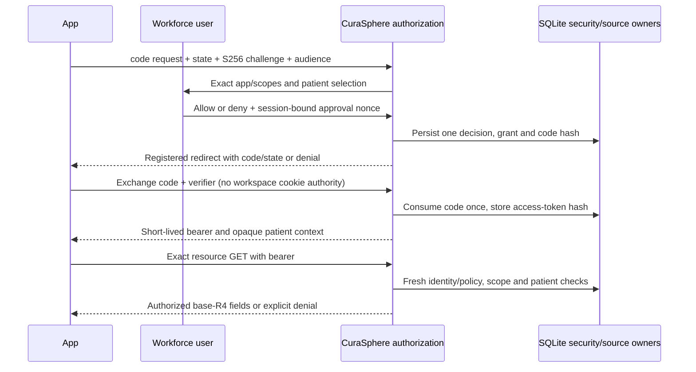

# P06-F02 — App authorization contract and operations

Local synthetic engineering only. See [plan](P06-F02-plan.md) and [ADR-0072](../adr/ADR-0072-local-smart-patient-grants.md). Formal Phase 06 remains NOT_STARTED. User approval of an app grant is not a qualified clinical/licensing review or a patient-consent determination.

## Data authority and lifetime

Clinical facts remain in their existing source tables. Schema 49 adds six security tables: smart_clients, smart_requests, smart_grants, smart_codes, smart_tokens and smart_controls. Client/grant context is immutable; client disable and grant revocation are terminal. Client registration keys are unique within the organization and bind exact normalized metadata. Grants reference the approved patient and original identity session; no clinical value or additional clinical repository is created. Existing auth/source audit and access-ledger bookkeeping remains authoritative for activity.

| Record | State/lifetime | Security meaning |
| --- | --- | --- |
| Client | active → disabled, versioned | Registered maximum scopes and exact redirect; disable invalidates grants |
| Request | pending → allowed/denied, ten minutes | Bound original session/facility/purpose and hashed approval nonce |
| Code | unused → used, sixty seconds | Hash only; client/redirect/PKCE binding; replay revokes grant |
| Grant | issued → revoked or expired, at most five minutes | Immutable patient/audience/context; issued does not imply current live authority |
| Token | hash reference to grant, at most grant expiry | Effective access requires all current identity, policy and grant checks |

Security metadata is retained locally for audit; expiration removes authority, not the evidence. There is no new destructive purge job, refresh workflow or outbox/provider delivery. Clinical retention/legal-hold restrictions remain intact. Production retention and external-sharing decisions require their separate qualified reviews.



## HTTP contract

Configured origin: `CURASPHERE_SMART_ORIGIN`, default `http://127.0.0.1:3000`. It must be a loopback HTTP(S) origin without credentials/path/query. Audience is that origin plus `/api/integrations/r4/smart`, never an arbitrary request Host. The built-in callback is exactly `/interop/apps/callback` on that configured origin. External local callbacks use, for example, `http://partner.smart-client.localhost:8091/callback`; the application must actually run on that separate port, and its browser/DNS must resolve the reserved localhost namespace to loopback. Workspace routes refuse reserved client hostnames.

| Endpoint | Contract |
| --- | --- |
| `/.well-known/smart-configuration` and FHIR-base `/.well-known/smart-configuration` | Public subset metadata; no clinical data or session |
| `GET /interop/apps/authorize` | response_type=code, client_id, exact redirect_uri, exact aud, explicit scope, state (16–512 chars), S256 challenge; authenticated treatment user |
| `POST /api/smart/decision` | Same-origin, original session, requestId, nonce, explicit allow/deny and selected patient; one-time transactional decision |
| `POST /api/smart/token` | URL-encoded authorization_code, client_id, exact redirect_uri, code, verifier; no client secret or cookie fallback |
| `GET /api/integrations/r4/smart/{type}/{id}` | SMART bearer only; exact SHA-256 FHIR ID and patient/{type}.r; no search/query/mutation |
| `POST /api/smart/revoke` | Public-client ID and token possession; unknown token returns 200 without an existence oracle |
| `POST /api/smart/manage` | Same-origin workspace forms: administrator registration/disable, owner or organization-administrator grant revoke |

OAuth forms are bounded to 8,192 bytes, valid UTF-8, supported fields and no duplicate singleton keys. PKCE verifier syntax is 43–128 permitted characters, challenge is S256 only. Codes/tokens use separate unpredictable prefixes from identity sessions and are never interchangeable. All security and resource responses use no-store. Token errors are OAuth JSON; resource errors are OperationOutcomes with bearer challenges for 401/403. Unexpected failures do not include SQL, values or raw tokens.

Cookie authority is deliberately excluded from token/resource endpoints. Every bearer read reloads the original session, even if an unrelated valid workspace cookie is present. Current user suspension, logout, purpose/facility mismatch, role loss, client disable, grant/token expiry or revocation denies access. App scope is checked before source lookup, and the returned resource must still point at the granted patient. Read access is the intersection of app scope and current source permission.

Only registered origins receive OAuth/resource CORS; no credential CORS is emitted. Discovery has public CORS because it contains no PHI. Origins with opaque `null` are not accepted as registered clients or workspace form origins. Namespace protection is shared through the lightweight contracts helper; unrelated workspace paths retain their previous behavior, including the existing patient-mobile CORS branch.

## UI and realistic simulation

`/interop/apps` links from Interoperability. Organization administrators register/disable clients and inspect organization grant metadata; treatment users start the local app and revoke their own grants. Patient selection uses actual persisted master records. Scopes and redirects are shown before allow/deny. There is no automatic patient matching or all-patient grant. Registered callback state, not a fake success response, determines whether the simulation can exchange a code.

Unauthenticated app launches preserve the original request while the existing sign-in/MFA flow runs in a separate tab; returning and explicitly continuing revalidates it under the chosen identity. This does not invent a new identity provider or bypass authentication.

The built-in client validates browser-bound state, exchanges with WebCrypto-generated S256 proof, reads an actual scoped R4 resource and can revoke then verify refusal. It never displays/stores the bearer in URLs or persistent browser storage. An expired/lost/reused exchange must restart authorization; it cannot silently renew. Denial is a real terminal request state. Loading, protocol/network failures, scope errors, context mismatch and expired/revoked access are shown as actual outcomes. The callback and error fallback have an accessible main target. Browser tests additionally run a real local partner HTTP server on an ephemeral port and verify cross-origin bearer/CORS behavior and absence of workspace cookies.

App data deliberately omits the proprietary source-context extension and custom profile assertion. Internal previews use source mapping 1.0.1, excluding transport correlations that could contain historical session identifiers. Clinical fields, coding pins, original rows and null/state fidelity remain preserved internally. Profiles remain 1.0.0. App R4 views are read-only projections, not inputs for source reverse/import commands.

## Operate, observe and recover

Audit actions include smart.client.register/disable, smart.authorize.request/allow/deny, smart.token.issue/reject/revoke, smart.resource.read/scope-denied/deny and smart.grant.revoke. Events contain app IDs and session attribution/outcomes, not token values, code/verifier strings or resource JSON. Security tables preserve the request/grant linkage needed to investigate purpose, patient context and scope. Unknown anonymous tokens are not logged as if an app were authenticated.

Set smart_controls dependency to unavailable only in a disposable test/operator-controlled local database to exercise fail-closed behavior. Restore it and retry while the original session/token remains valid. Foundation identity unavailability also denies resource access; it does not substitute a cached user. Database failures produce unavailable responses, never fake tokens or clinical success. If a code exchange response is lost after processing, restart authorization or explicitly revoke the issued grant; replay cannot duplicate authority. Repeated revocation is safe. File-backed reopen and two-process code races are exercised.

Operational rollback retains schema 49 and security evidence, revokes grants/disables clients, and closes the SMART dependency. Do not run a schema-48 build against a schema-49 database. A full physical restore is only for a separately reviewed disposable local copy after retaining audit and comparing clinical facts. `SMART_FIXTURE_ROLLBACK` is explicitly for disposable fixtures; it is not a production migration reversal. Before activation, a consistent schema-48 backup was created at `artifacts/governance-v2/P06-F02-before-1b158030-4990-4890-81d1-59afe2c2e212.sqlite`.

## Verification commands

```text
npm test
npm run smart:test
npm run typecheck
npm run lint
npm run build
npx playwright test tools/e2e/p06-f02.spec.ts
npm run fhir:fixtures
npm run fhir:validate
npm run governance:v2:test
npm run governance:test
```

The CI FHIR job runs the source/SMART domain and HTTP suites and validates generated delegated resources in addition to the existing profiles. Local test reports are evidence; remote CI is not claimed executed until a remote job runs. No native-device SMART flow, full SMART certification, production clinical release, external legal consent, backend-service grant or F03 delivery/import implementation is claimed.
