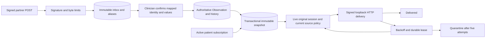

# Signed partner exchange — architecture and operations

Local synthetic use only. Formal Phase 06 is NOT_STARTED. See [plan](P06-F03-plan.md) and [ADR-0073](../adr/ADR-0073-signed-local-partner-exchange.md).

## Interfaces and state

`POST /api/integrations/partners/{connectionId}/messages` accepts raw `application/json`, at most 65,536 UTF-8 bytes, no cookie or browser Origin. Headers: `x-curasphere-message` (1–80 identifier characters), `x-curasphere-timestamp` (13-digit Unix milliseconds, ±300 seconds), `x-curasphere-signature` (64 lowercase hex characters). HMAC-SHA256 input is exactly `curasphere-v1\n{connectionId}\n{messageId}\n{timestamp}\n{rawBody}`. Timestamp authentication is not a substitute for persistent idempotency. Retrying outside the time window requires a fresh timestamp/signature and the same ID/body. The connection itself determines tenant and facility. Clients cannot supply scope headers.

Returns 202 for a durable receipt, including quarantined payloads, or 200 for an identical prior receipt. Inspect `status`/`diagnostic`; 202 never means a clinical write occurred. Conflicting message bytes return 409. Signature failures return 403; oversized/unsupported transport returns 422; disabled connections return 409. Malformed JSON with a valid signature is retained in quarantine. Invalid signatures do not persist their bodies. Alternate delivery IDs for the same accepted resource/version are durably aliased to the original receipt; reusing any alias with other bytes conflicts.

Envelope: `{contractVersion:1, sourceVersion:positiveInteger, resource:Observation}`. Inbound supports one quantity Observation with exact synthetic catalog code/system/version, matching unit/code/system, finite catalog-bounded value, subject `Patient/{partnerId}`, encounter `Encounter/{partnerId}`, canonical UTC millisecond effective time, and status preliminary/final for creation or corrected for corrections. Optional `meta.versionId` must equal `sourceVersion`. Use the canonical synthetic system `urn:curasphere:source-system:curasphere.synthetic.observation` and quantity system `urn:curasphere:source-system:curasphere.synthetic.ucum-style%2F2026.10`; these are not licensed LOINC/UCUM assertions. Unknown and duplicate JSON fields, multiple codings, components, additional resources, unconstrained text and unsupported value types are quarantined. These limits are deliberate, visible contracts; this is not a general FHIR transaction endpoint. Outbound source snapshots additionally support component observations; partners must support that outbound representation or return an error. No clinical fields are silently discarded from inbound accepted messages.

`GET /api/integrations/partners/workspace` returns current scope-filtered metadata; `?import={id}` retrieves an authorized mapped valid import and its local identity for review. No signing key, original session ID or raw payload is in the list response. Unknown malformed payloads expose diagnostics only, not a clinical body. The latest 200 receipts and deliveries are shown; bulk pagination/reconciliation is deferred to F04. Mapped records denied by current patient policy are hidden. Unmapped identity payloads require a confirmed link and a new correctly identified message; arbitrary identity retargeting is prohibited.

`POST /api/integrations/partners/workspace` requires a live workspace session and exact Origin. JSON commands reject unknown fields:

| action | fields | authority |
|---|---|---|
| register | name, endpoint, idempotencyKey | organization.manage |
| key | id | organization.manage; audited explicit disclosure |
| disable | id, version | organization.manage |
| link | connectionId, externalPatient, externalEncounter, patientId, encounterId | treatment + patient/encounter access |
| review | id, approve (boolean) | treatment + patient/encounter + existing record/correct permission |
| subscribe | connectionId, patientId | treatment + authorized patient |
| transition | id, version, status | subscription owner; active/paused/ended |
| export | subscriptionId, sourceId | owner + current source read |
| deliver | id | owner + original live session/patient gate at delivery |

Schema 50 adds connection, immutable identity-link, inbox/alias, resource-head, subscription, outbox and dependency-control tables. Source record/history/coding and applied resource heads are one transaction. The shared transaction helper uses nested savepoints and a per-database depth fallback for Node releases without runtime `isTransaction`. Nested failure rolls back its savepoint; outer failure rolls back the source and all integration metadata. Unique accepted resource/version and outbox subscription/source/version keys prevent double creation. The link command also enforces stable partner-patient and encounter identity across links inside the serialized write transaction. Malformed bodies remain immutable evidence. Only owning facility/tenant and authorized clinical users can inspect payloads.

Subscriptions start active, pause/resume with a version check and may end permanently. Connection disable is terminal. New source changes queue only for active subscriptions/connections; resume does not backfill changes while paused. An explicit export queues the current source version. Outbox states: queued → sending → delivered, or retry → sending; exhausted work is quarantined. Revoked authority, ended subscription or disabled connection cancels outstanding work. Stable IDs permit receiver deduplication. An expired 15-second lease can be reclaimed; no more than five claims are permitted. Retry delay is `min(300000, 1000 * 2^attempts)` milliseconds. Paused work remains retained. No F04 replay/resumable cursor is implied.

## Local operation and recovery

Set the four existing local/synthetic sandbox variables and a stable private `CURASPHERE_INTEGRATION_KEY` of at least 32 bytes. The root is never returned; admin key disclosure derives a connection-specific HMAC key. Store the root outside Git, preserve it across restarts and transfer only each partner's derived key to that partner process. Local workspace uses the ignored `data/.env.local`; load it explicitly in each worker/server process. Key loss or replacement stops authentication with existing partners; restore the original root or register a new connection and redistribute its derived key. No automatic key rotation is claimed.

Outbound endpoint must be exact `http://127.0.0.1:PORT/curasphere/webhook`, port ≥1024 excluding workspace/identity/mobile/Dex ports 3000, 8081, 8082 and 15556. No hostnames, DNS resolution, credentials, fragments, queries or redirects are allowed. No production network is enabled. Fetch timeout is two seconds; response bodies are cancelled and never logged. An attempt already in flight when authority is revoked cannot be recalled; future claims stop. Receivers must commit idempotently before acknowledgement. No exactly-once network claim is made.

Run one bounded queue pass with `npm run integrations:worker` in the configured environment. The worker reloads Foundation sessions for `ses_` IDs, otherwise existing local SQL sessions; never reconstruct authority from persisted user fields. At most 20 eligible jobs are considered. Output contains only aggregate status counts. Use an operator-managed scheduler if desired; no hidden background worker is installed. Current UI and API expose status, attempt count and next eligible time. Alert on quarantined rows, repeated network failures, or old eligible queued work; investigate the scoped record without copying its body into logs.

For a real local receiver, set `CURASPHERE_PARTNER_CONNECTION`, `CURASPHERE_PARTNER_SECRET` (the disclosed derived key), optional `CURASPHERE_PARTNER_PORT` and `CURASPHERE_PARTNER_DATABASE`, then run `node --import tsx tools/integrations/partner-server.ts`. It binds literal loopback, validates the signed quantity contract and persists idempotent delivery receipts in SQLite. It is a synthetic receiver, not a connected external EHR. Use `node --import tsx tools/integrations/send.ts tools/integrations/fixtures/temperature.json` to actually send a signed inbound message after linking its identifiers. Set a stable `CURASPHERE_PARTNER_MESSAGE` to exercise retries. Its output excludes keys/bodies. The fixture file's date may be adjusted to the reviewed simulation encounter.

Dependency failure: set `integration_controls.dependency='unavailable'` to fail exchange closed; clinical recording still preserves queued snapshots transactionally for recovery. Restore available and original identity/key dependencies, refresh UI and run the worker. Session expiry/revocation is terminal for queued authority; do not mutate stored authority to restore delivery. Resume an eligible subscription with a new authorized session and explicitly export the current record. Quarantined imports are never automatically promoted; inspect diagnostics, fix the producer and submit a new message. F04 will add controlled reconciliation and replay.

Operational rollback: disable connections, stop worker invocations and retain schema 50, keys, source rows and evidence. Do not run a schema-49 application against schema 50. A forward fix is preferred. `INTEGRATION_FIXTURE_ROLLBACK` is destructive test-only SQL, not an operational rollback. Retention/deletion of clinical payloads follows the platform's controlled policy; this feature introduces no automatic purge. Local receipts/attempts and scoped audit events remain available for review; no clinical details or bearer/signing credentials belong in metrics.
