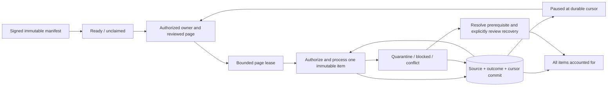

# P06-F04 — Bulk movement and reconciliation operations

Local synthetic use only. Formal Phase 06 and qualified reviews remain separate. See [plan](P06-F04-plan.md) and [ADR-0074](../adr/ADR-0074-resumable-reviewed-integration-batches.md). This extends the F03 Observation contract, not the HL7 Bulk Data file protocol or a general-purpose FHIR transaction server.

## Transport and ownership

`POST /api/integrations/partners/{connectionId}/batches` accepts at most 262,144 UTF-8 bytes and 1–100 messages. No Cookie, Origin or query string is accepted. Use the existing `x-curasphere-message`, timestamp and signature headers. The header message ID is the immutable external batch key. HMAC input is exactly `curasphere-batch-v1\n{connectionId}\n{batchKey}\n{timestamp}\n{rawBody}`. This domain separation prevents a single-message signature from authenticating a batch. Timestamp window and per-connection derived key follow F03.

Body: `{contractVersion:1,messages:[{messageId:"unique-within-batch",body:"exact individual JSON string"}]}`. Each contained string is at most 65,536 bytes and retains its SHA-256 hash. Envelope duplicate/unknown fields, oversized manifests and duplicate message IDs reject the manifest. Invalid individual FHIR payloads remain immutable items and become explicit quarantined outcomes when reviewed processing reaches them. Authentication occurs before persistence. Reused external batch key with identical bytes returns the original batch; different bytes conflict. Receipt returns 202/200, never a clinical success claim.

An unclaimed import appears as scoped metadata. Only an actor with current treatment/Observation-recording authority can claim it. Ownership is immutable in application commands; another user/tenant/facility cannot preview/process the owned batch. Current patient/encounter policy is applied separately to every item preview and clinical write. Unauthorized, malformed or unmapped bodies are not disclosed merely because a batch is visible. Identity mappings remain explicit, immutable and partner-scoped.

The existing signed sender supports batch mode: configure the four local sandbox variables, partner connection and derived secret as before, set `CURASPHERE_PARTNER_BATCH=true`, then run `node --import tsx tools/integrations/send.ts PATH_TO_MANIFEST.json`. Use a stable `CURASPHERE_PARTNER_MESSAGE` for byte-identical receipt retries. Output contains only receipt metadata. No new production key or network permission is introduced.

## Review, checkpoints and partial failure

`/interop/reconciliation` lists owner/unclaimed work, filters status, follows opaque queue cursors and opens item pages. Refresh explicitly to see provider work submitted after the current page snapshot. Claim, inspect mapped identity/clinical values, attest the displayed page, then apply it. UI pages contain five items; API processing permits 1–10. Reload and select **Load saved cursor** to continue. Earlier processed item pages remain inspectable. Buttons do not claim remote acknowledgement for queued exports.

Schema 51 adds batches, immutable items, page-run receipts and immutable recovery history; outbox gains recovery count/version. A page claim holds a 15-second lease. Every individual clinical command, its source history/outbox, item result and cursor advancement commit in one transaction. Each commit renews the lease. The cursor cannot jump over a database/source-dependency failure. Completed prior items remain committed. Known per-item validation, version or authorization failures are retained as quarantined/conflict/blocked outcomes and count as accounted-for items; the report distinguishes them from applied data.

Page commands carry expected batch version/cursor, immutable manifest hash, a command key and explicit attestation. Duplicate completed page keys perform no further writes and render fresh policy-checked results. The persisted run response contains progress metadata, not a cached clinical page. Same key/different arguments conflicts. A run lost after partial commit resumes its saved end boundary after lease expiry; it never treats its previous items as new work. A new page key requires the current cursor/version. Active competing leases conflict. Cancellation preserves committed outcomes and leaves remaining items queued under a cancelled batch; it is not clinical rollback.

Import applies only the F03 bounded quantity-Observation contract through existing clinical services. Duplicate messages across pages account for both items but create one source event. Corrections preserve prior source versions and refuse intervening local edits. A completed batch can contain failed items; completion means accounting reached the manifest end, not all clinical imports succeeded.

## Export and recovery

Create an export from an owned active patient subscription bound to the current session. Pause/resume an older subscription in Partner exchange first. The export captures up to 1,000 current facility/patient Observation IDs and source versions in a serialized snapshot. Zero or more than 1,000 explicitly fails; there is no silent truncation. Later pages recheck each source version in the same transaction as F03 export queueing. Changed/removed/inaccessible data becomes a conflict; a fresh reviewed manifest is required rather than substituting another version. Exports queue the actual F03 resource snapshots; source changes remain authoritative. Run the existing worker for actual signed delivery.

Receipt recovery never edits original bytes. After an identity or ordering prerequisite is resolved, a controlled recovery creates/reuses a new pending receipt referencing the immutable original and records operator/reason. Standalone receipt recovery does not itself apply clinical data; review it in Partner exchange. For a failed import batch item, inspect and use **Apply recovered item** to explicitly revalidate and apply its eligible correction. Unsupported/malformed bytes cannot be promoted; repair the producer and submit a new message. Local source conflicts cannot be overridden by this interface.

Delivery redrive is limited to quarantined/cancelled work with a currently active, owned subscription and current bound session, current patient/source permission and active connection. Disabled connections/ended subscriptions remain terminal. If authority was refreshed, explicitly pause/resume the eligible subscription first. At most three redrive generations are allowed. Prior status/attempt count, operator, reason and command hash are retained. The same delivery ID/body/hash is sent again, with a fresh transport timestamp/signature; the receiver must deduplicate it. Current attempts reset only after an audited CAS-protected redrive. An in-flight send cannot be recalled. Maximum claims are five per generation, at most twenty including the initial generation.

If a reviewer leaves the organization, do not alter stored ownership or invent service-principal authority. An authorized partner may resubmit the identical individual messages under a new external batch key for a new eligible reviewer; connection/message and source-version idempotency preserve already applied data. There is no automatic ownership transfer.

## API reference

All workspace endpoints require the live existing session, exact public Origin for mutation, no-store responses and current source policy. Unknown/duplicate query fields and unknown command fields are rejected. Error responses redact unknown implementation failures.

| Interface | Contract |
|---|---|
| `GET /api/integrations/reconciliation?kind=batches|receipts|deliveries&status=&limit=1..20&cursor=` | Scope-filtered keyset page; a page can be empty after authorization filtering while a next cursor remains |
| `GET ...?id={batchId}&after={sequence}&limit=1..10` | Current progress, outcome totals and authorized previews |
| POST `claim` | `id` |
| POST `export` | `subscriptionId, commandKey` |
| POST `process` | `id, version, cursor, limit, commandKey, manifestHash, attested:true` |
| POST `cancel` | `id, version` |
| POST `reconcile` | `id, seq, version, commandKey`; explicit reviewed clinical recovery |
| POST `recover` | `id` (receipt), `commandKey, reason` |
| POST `redrive` | `id` (delivery), `version` (recovery version), `commandKey, reason` |

Dashboard cursors bind a hash of organization/facility/user/purpose/session, queue/filter/page size and creation high-water mark; expire after fifteen minutes and are HMAC-authenticated with a distinct derived key. Tokens contain no plaintext session or clinical body. They are live operational listings, not frozen status snapshots. Manifest sequences and clinical accounting are independently immutable; changing dashboard filters cannot change batch membership.

## Operations, monitoring and rollback

Monitor outcome totals, cursor versus manifest size, paused/running leases and failed delivery statuses through the dashboard/API. Investigate blocked/changed-source outcomes before retry. Use aggregate worker output and scoped audit IDs; never copy clinical payloads, signing keys or session tokens to general logs. Payload retention is controlled evidence retention; no automatic purge is introduced. Each import is bounded by 100 messages/256 KiB, export by 1,000 IDs, processing by ten items per request and dashboard by twenty rows. No production throughput/SLA claim follows from these limits.

On database/source dependency failure, restore the dependency, reload the durable cursor and resume the same page key after an expired lease or use a fresh reviewed page at the current cursor/version. Do not advance cursors manually or reset source versions. Missing signing roots prevent new authenticated transport and cursor/redrive operations; restore the original root, not a regenerated replacement. Client disconnect/lost response requires reloading authoritative progress rather than assuming rollback.

Historical batch progress/outcome metadata remains readable under current owner/tenant/purpose gates after a connection is disabled; sensitive item previews and further processing remain blocked.

Operational rollback cancels remaining batches, ends test subscriptions/disables connections and stops workers, preserving schema 51, clinical records and evidence. Keep a schema-compatible application; do not start a schema-50 build against 51. Prefer a forward fix. `INTEGRATION_BATCH_FIXTURE_ROLLBACK` destroys fixture batch/recovery tables and columns; it is only for disposable test databases. Failed-migration and genuine process-termination tests verify atomicity/durability. Source/clinical production flags and formal review records are untouched.
