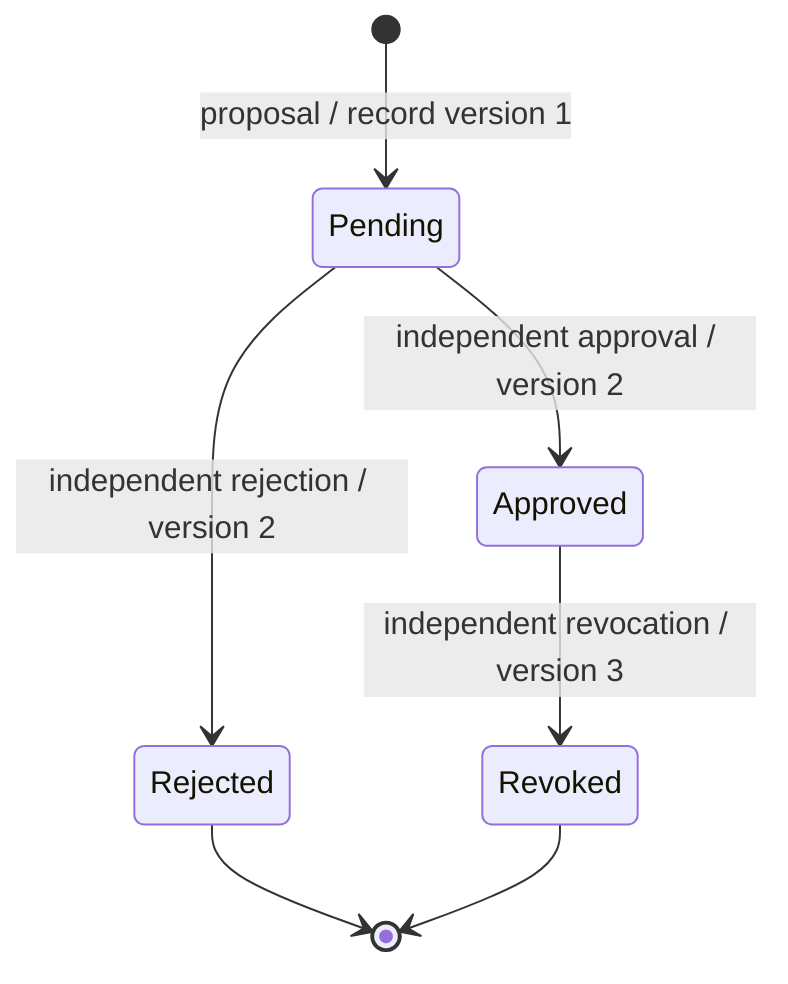

# P05-F03 — Mapping adjudication

## ADR P05-F03-01: immutable proposals with independent decision events

Existing global clinical vocabularies and clinical source records remain unchanged. Schema 46 extends controlled synthetic releases with mapping proposals, append-only review events, actor/payload-bound command receipts and a derived current-state view. Both source and target are composite foreign-key pins to immutable release concepts. Organization constraints prevent linking a foreign release or review. No licensed content or confidence score is imported or inferred.

The mapping version identifies an explicitly requested mapping edition; record version is a separate optimistic-concurrency counter. A proposal starts pending at record version 1. An independent reviewer may approve or reject it at version 2. Approval may subsequently be revoked at version 3. Rejected/revoked proposals are terminal; corrections require a new mapping version. Neither proposals nor prior decisions can be edited or deleted. Database triggers independently enforce tenant, proposer/reviewer separation, transition order and consecutive event versions.

Each proposal pins source system/code/version, target system/code/version, mapping version, target relationship to source (equivalent/broader/narrower/related), effective interval, HTTPS reference, rationale, manifest digest, proposer and creation time. Reviews retain actor, decision, reason, record version and time. The digest identifies the normalized proposal, not independent clinical validation. Creation/review, idempotency receipt, metadata-only outbox event and audit entry share one transaction. Failed reviews are audited outside the rolled-back transaction, without disclosing foreign resource IDs.

## Safe translation

Translation requires exact source tuple, target system/version and mapping version. It validates active controlled source and target releases, then considers every effective pending/approved candidate in that organization and requested edition. Dates are UTC calendar dates; end dates are exclusive. Proposal intervals must stay within both release intervals.

Only one effective approved **equivalent** candidate, with no pending competitors, may return a selected target. Pending competitors, multiple approved candidates, a non-equivalent approved relationship or no approved match return status=needs-review with reason=pending-review/ambiguous/non-equivalent/unmapped, candidate IDs/state/relationship/version and a review-queue link. There is no selected target in those responses. Rejected, revoked, future or expired mappings cannot resolve. No latest-version guess, similarity score, molecular conversion or silent fallback is used. Approval alone does not authorize a broader/narrower/related substitution.

The review queue includes pending proposals, approved competing candidates and approved non-equivalent relationships. Thus approval cannot hide unresolved semantic ambiguity. A reviewer may reject or revoke an unsuitable competitor; historical decisions remain visible. The inspector never writes clinical facts. Formal clinical acceptance is a separate unresolved process.

## API contract v1

Cookie workforce sessions, active account/membership/facility scope, local synthetic flags and dependency availability apply to all operations. terminology.read permits inspection; terminology.manage permits proposal; terminology.review permits decisions. The local review permission is assigned to organization administrators, doctors and pharmacists, but never bypasses the independent-reviewer check. Permission is not proof of a clinician's qualified signoff. Patient portal users receive no access.

| Route | Contract |
| --- | --- |
| GET /api/terminology/mappings?view=review or all | Up to 100 tenant-scoped rows, record state/version and queue reason; review is default |
| POST /api/terminology/mappings | source/target {system,version,code}, mappingVersion, equivalence, activeFrom, optional activeTo, sourceUrl, rationale, idempotencyKey; 201 or identical replay 200 |
| POST /api/terminology/mappings/ID/review | decision, expectedVersion, reason, idempotencyKey; 200 decision receipt; stale/competing decision 409 |
| POST /api/terminology/translate | source {system,version,code}, targetSystem, targetVersion, mappingVersion; 200 resolved or needs-review result |

Unknown fields, including confidence and client-supplied actor/tenant, are rejected. Shared bounded JSON validation and foreign-Origin protection apply. All responses use no-store. Errors: 401 sign-in required; 403 role, self-review or content restriction; 404 unavailable/foreign resource; 409 immutable version or changed/stale command; 422 invalid/unknown/ineffective code or interval; 503 dependency failure. No patient data is accepted. Provenance URLs require HTTPS without credentials, query tokens or fragments.

Outbox types terminology.mapping.proposed.v1 and terminology.mapping.reviewed.v1 contain contractVersion, mappingId, record version and status. Consumers must fetch authorized immutable provenance by ID, rather than infer clinical equivalence from an event. No external delivery/provider is enabled. Identical actor/payload-bound retries return their original receipt, even if the mapping subsequently changed; replayed=true is explicit, and the UI reloads the current version.

## User guidance

Open Terminology → Mapping review and translation. An administrator copies exact tuples from controlled releases, declares the target's relationship, supplies effective dates and provenance, and submits a proposal. There is no auto-approval. A different authorized account opens the detail, inspects both linked releases and rationale, and records a decision with a reason. The proposer sees the independent-review requirement and cannot submit a self-decision through either UI or API.

On conflict, reload the current mapping before choosing a still-available action. On connection failure, retry the unchanged submission so its key recovers the original result. Controls lock while a request is pending. Inspection input changes clear the previous result. Errors remain visible; no saved clinical record is claimed. The detail shows full decision history. Mobile uses the existing separately authenticated registry web handoff; no session token appears in a URL and no native clinical editor is added.

## Operations, monitoring and recovery

Observe durable pending/approved/rejected/revoked states, queue reasons and outbox receipts by organization. Audit actions terminology.mapping.propose/read/list/approved/rejected/revoked/review/translate record outcome and authorized resource identifiers, without patient data. A needs-review translation records a denied resolution rather than a successful substitution. Investigate growing pending/conflict queues or repeated denied/stale reviews; resolve through the independent UI workflow, never by editing state tables or enabling a clinical bypass.

Setting the existing terminology dependency control unavailable denies mapping reads/writes/translation and shows a retryable error; it never produces a guessed result. Invalid source/target releases and unsupported content fail closed. No service-availability, load or clinical-safety certification is inferred from local tests.

Before rollout a consistent VACUUM INTO snapshot captured schema 45, 21 patients, 19 releases and 9 value-set versions. Its exact path is in artifacts/governance-v2/P05-F03-backup.log. Schema-46 DDL and marker commit atomically; failure retains schema 45 and allows repair/retry. Injection tests verify no partial schema or marker survives. Outbox failure tests verify no partial proposal or review persists.

Operational rollback disables the new routes and retains immutable proposals/decisions. Do not run older schema-45 code against schema 46. Snapshot restoration loses subsequent activity and is not an automatic downgrade. TERMINOLOGY_MAPPING_FIXTURE_ROLLBACK removes only disposable-test extensions; prior fixture teardowns remove 46 before 45/44. Protected governance records and formal registers remain unchanged.

## Risk and review boundary

| Hazard | Control and verification |
| --- | --- |
| Wrong or non-equivalent target silently selected | Explicit relationship; ambiguity/non-equivalence return no target; domain and browser oracles |
| Proposer approves own mapping | Active permissions plus independent actor check and database trigger; denial/audit tests |
| Concurrent reviews overwrite a decision | expectedVersion, unique consecutive event version, transactional receipt; stale/concurrent API tests |
| Cross-tenant disclosure or forged actor | Server-derived scope, release/review constraints, permission gates; two-tenant tests |
| Semantic drift or expired source | Immutable composite pins, explicit versions and effective intervals; stale/expired tests |
| Partial persistence | Atomic proposal/review/outbox/audit; forced failure and migration recovery tests |
| Simulation approval mistaken for clinical approval | Local synthetic gate, UI wording, no clinical write integration, formal acceptance ungranted |

Formal Phase 02 reviews remain pending; formal Phase 04 is NOT_STARTED. Clinical, regulatory, jurisdiction, licensing and qualified reviewer approvals are not supplied by these artifacts. P05-F04/F05 remain later features. No push, merge, publish or deployment is part of this change.
