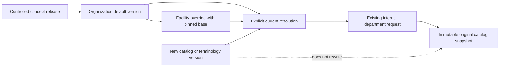

# P05-F04 — Facility catalog and formulary

## ADR P05-F04-01: version metadata, reuse the existing request workflow

The repository already has immutable billing charge-item snapshots, legacy formulary facts, and an internal work_orders/task/history workflow. This feature does not replace medication facts, invent a second ordering service, change tariffs or activate prescribing. It adds controlled administrative catalog metadata and a version pin to the existing synthetic department-request transaction.

Schema 47 contains immutable facility_catalog_versions, explicit facility_catalog_heads, actor/payload-bound facility_catalog_commands and immutable work_order_catalog_pins. Default scope is organization-wide within one tenant. Facility overrides use only the session's active facility, never a client-supplied facility/organization. Head changes use expectedRevision and compare-and-swap; prior versions remain immutable. Head deletion is prohibited to prevent removing a block and reopening a default.

Every version records catalog key, scope, revision, optional base version, exact controlled concept release/code, kind, department category, local description, unit and unit-pack version, active/inactive/retired state, effective interval, provenance reference/note, creator/time and normalized manifest digest. Same-key revisions retain kind, department category and canonical system/code identity; they may explicitly advance the terminology version. A different concept requires a new key. Retired is terminal; use inactive for reversible blocking. Corrections append versions and move a head, never edit history.

An override pins the exact current organization-default version and retains its coded identity/kind/category. When that default changes, the override becomes stale and blocks selection until a manager registers a new override. Inactive, retired, expired, future or stale overrides never fall back. An inactive/ineffective default cannot be bypassed by an active override. Unknown keys return no available item. End dates are exclusive UTC calendar dates; intervals remain within the controlled release's dates. Registered official reference metadata cannot provide usable catalog content.

## Units, drug metadata and clinical boundary

curasphere-catalog-units-2026.11 is a restricted administrative metadata pack: the existing independently authored mathematical symbols plus local count symbol 1. It does not change the F02 conversion pack, claim general UCUM conformance, establish clinical unit bindings, or supply dosing/strength guidance. Exact symbols are required; aliases/unknown units fail.

Drug entries are formulary metadata only. They appear as “Metadata only”, are omitted from request pickers and are rejected by the domain request integration. No prescribing, pharmacy fulfillment, dispensing, medication source rewrite or new clinical activation is enabled. Test entries route only to laboratory departments; procedures route to nursing/imaging according to their explicit category. Existing work permissions, patient/encounter/practitioner checks, consent behavior, closure restrictions and no-transmission gates are preserved. Legacy request choices remain supported; broader picker conformance belongs to P05-F05.

## Order preservation

submitOrder optionally accepts catalogItemVersionId. The server derives code/system/version/description/category from the selected version, ignoring any client attempt to supply a different catalog description/code. Current eligibility is checked before validation and again inside the order transaction, preventing a stale head from racing submission. The order, task, history, command receipt, audit and catalog pin commit together. A pin failure leaves no partial request or task.

The snapshot retains entry version ID, catalog key/revision/scope/base, release ID, system/code/version, description, kind/category, unit/pack and digest. readOrder exposes it only after existing order visibility and work permissions pass; it reads the pin, not a current catalog head. Routing/cancellation and encounter closure do not alter it. Identical previously recorded requests can recover their original receipt even after the catalog changes or the encounter closes. New catalog-request keys/hashes bind actor, active facility and selection; legacy idempotency recipes remain compatible. No prior order is backfilled with invented catalog provenance.

## Contract and permissions

All new catalog operations require an active workforce session/account/membership, local synthetic flags, server-derived scope and the existing terminology dependency gate. terminology.read permits inspection. facility.catalog.manage permits active-facility changes for organization/facility administrators and pharmacists; organization defaults additionally require terminology.manage. These are simulation software permissions, not qualified clinical approval. Client-supplied facilityId/organizationId/actor and unknown JSON fields are rejected.

| Interface | Contract |
| --- | --- |
| GET /api/terminology/catalogs | Up to 100 current keys with resolved item/origin, availability, blocking reason and default base ID/revision |
| POST /api/terminology/catalogs | catalogKey, scope, expectedRevision, optional baseVersionId, concept{system,version,code}, kind, orderCategory, display, unitCode, status, activeFrom, optional activeTo, sourceUrl, sourceNote, idempotencyKey; 201 creation or 200 identical replay |
| GET /api/terminology/catalogs/resolve?key=... | Explicit current item or unavailable result; never guessed/defaulted for an unknown key |
| POST /api/work/orders | Existing form plus optional catalogItemVersionId; server revalidates it and preserves the exact snapshot |

New JSON routes use contractVersion 1, no-store, bounded known-field bodies, foreign-Origin protection and 401/403/404/409/422/503 failures. HTTPS provenance URLs reject credentials, query tokens and fragments. Catalog item changes atomically append version/head/receipt/audit and terminology.catalog.registered.v1 outbox metadata (entryVersionId/key/revision/scope/status). No patient data or external delivery is in that event. Foreign-Origin protection also applies to the existing order form endpoint.

## User and operator guidance

Open Terminology → Facility catalog and formulary. Register a current organization default first. Use an exact controlled concept, explicit kind/unit/status/interval and source rationale. A facility manager can then choose the corresponding current default as the base of an active-facility override. Revision 0 means a first entry in that scope; existing entries require their current revision. Open a current version's “Create next revision” action to prefill its explicit next-version form. Historical versions cannot silently serve as a current edit template. Conflict errors require reloading current metadata; unchanged network retries retain their submission key.

Staff see the resolved origin and availability reason. In a department request, selecting a versioned facility item supplies its exact code/description; the established request list is used only when explicitly selected instead. Choose a matching department. A stale/blocked choice is rejected rather than changed silently. The request detail shows “Original catalog version” and links immutable provenance. Historical snapshots remain readable even if terminology availability later changes. Mobile uses the existing separately authenticated web handoff; no session tokens in URLs or native prescribing editor are added.

Monitor persisted heads/revisions, blocked-resolution reasons, outbox receipts and audit actions terminology.catalog.register/read/list/resolve together with existing work.order.submit. Catalog writes and request pins are reconciled by immutable IDs and digests. Increasing stale override counts require explicit review/re-registration; repeated 409s require refreshing the expected revision. Do not remove heads or alter snapshots to restore availability. No clinical availability or performance certification is claimed.

## Migration, failure and rollback

A consistent VACUUM INTO snapshot precedes local rollout: schema 46, 21 patients, 29 releases, 11 value sets, 5 mappings and 2 existing work orders. The exact file is in artifacts/governance-v2/P05-F04-backup.log. DDL and marker 47 are transactional; injected conflicts leave schema 46 recoverable. Forced outbox/pin failures demonstrate no partial version/head/request survives.

On dependency outage, catalog operations fail closed. Existing historical order snapshots do not resolve through current catalog availability. Operational rollback disables new access while retaining immutable versions/pins. Do not run older schema-46 application code against schema 47. Snapshot restoration would discard newer activity and is not an automatic downgrade. FACILITY_CATALOG_FIXTURE_ROLLBACK is only for disposable tests; older fixture teardowns remove 47 before 46/45/44. Protected governance records remain unchanged.

## Risks and remaining reviews

| Hazard | Control and proof |
| --- | --- |
| Inactive or stale override reopens a default | Explicit blocked resolution; domain/browser inheritance cases |
| Lost concurrent catalog update | expectedRevision, unique revision and CAS head; concurrent API checks |
| Historical order meaning changes | Immutable composite concept pins and order snapshot; closed-encounter reopen tests after catalog/terminology update |
| Wrong tenant/facility or unauthorized default edit | Server scope, permission split, database constraints; two-tenant and facility-manager tests |
| Drug metadata becomes a prescription | Picker omission and domain rejection; no medication write/provider integration |
| Partial version or clinical request | Shared transactions, durable receipt, forced outbox/pin and migration failure checks |

Formal Phase 02 reviews remain pending; formal Phase 04 remains NOT_STARTED. Synthetic fixture actors and passing tests do not supply qualified clinical, regulatory, licensing or jurisdiction approval. P05-F05 and formal phase exit are not completed here. No push, merge, publication or deployment is authorized or performed.
