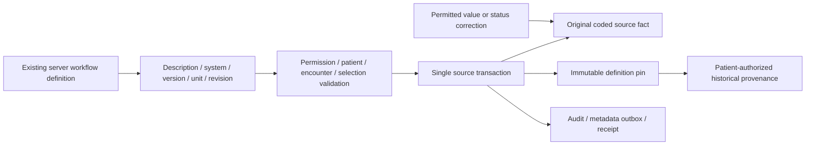

# P05-F05 — Clinical coding UX and provenance

## ADR P05-F05-01: retain workflow semantics, snapshot exact bindings

Existing source condition/allergy/observation/medication-draft and department-request services already validate fixed synthetic workflow codes and store system/version metadata. Their systems are explicitly synthetic, distinct from licensed terminology releases and tenant-authored catalog URNs. This feature does not promote them into a licensed standard, admit arbitrary registry terms into clinical writes, change clinical rule values, rewrite old facts or activate prescribing.

The shared picker displays current description, exact system/code/version, unit binding, revision digest and provenance link. The selected tuple/revision is submitted explicitly. The domain derives its own definition and compares supplied metadata; unknown codes, wrong systems/versions and stale revisions fail. Definitions include the existing server binding metadata/rules, never actual patient measurements or doses. A related/ambiguous mapping is inspectable but never substitutes for the selected clinical fact.

Schema 48 adds immutable organization-scoped clinical_coding_definitions and clinical_coding_pins. Canonical JSON sorts object keys recursively while preserving array semantics. SHA-256 identifies kind plus exact definition. Definition IDs additionally bind organization; identical definitions can be reused within a tenant. Pins bind organization/facility/resource kind/ID to that definition and author/time. Database guards match every pin to the actual source tuple. Pinned code/system/version/description cannot subsequently drift through a direct source-table update; clinical status/value corrections remain supported.

## Mutation and compatibility contracts

All new representative writes are pinned, including existing trusted domain callers that omit the optional selection object. Those callers still pass the original server allowlist, safety/permission/patient/consent/encounter checks; server-derived pinning is mandatory. Web recording routes require codingSystem, codingVersion, codingRevision and codingCommandKey from the rendered picker. Missing/forged selections fail rather than fall back. Source bounds and unit assertions remain the original synthetic test rules, not new medical guidance.

New selection-aware command hashes bind actor/facility and selected metadata. Existing internal idempotency recipes remain compatible. Each source transaction rechecks its command receipt after acquiring the write lock, so simultaneous identical submissions recover one logical record rather than create a duplicate. Suspended accounts are rejected before reading a cached mutation receipt. Source data, definition/pin, outbox, audit/history and command receipt commit together; coding persistence failure rolls all of them back.

The existing F04 facility selector remains supported. Choosing a current facility catalog item changes the active coding metadata to that item's exact concept/catalog revision and disables the unrelated legacy request selector. The server revalidates current eligibility inside the order transaction and retains both the F04 catalog snapshot and F05 coding definition. Drug metadata remains excluded and rejected. The old legacy list is used only when explicitly selected, not as a silent fallback.

Corrections keep the original coded identity and binding. New code selection requires a new source fact through the established workflow; this feature does not recode old records. Older records without a coding receipt retain their existing metadata and explicitly display historical unpinned status. No receipt, clinician approval, standard license or mapping is invented as a backfill.

## Interfaces and views

| Interface | Behavior |
| --- | --- |
| GET /api/terminology/pickers?kind=condition/allergy/observation/medication-order/work-order | contractVersion 1, authenticated scoped terminology.read; plain choice DTOs with code/system/version/description/unit/revision/provenance link; no patient data |
| GET /api/terminology/conformance | terminology.manage, active facility; counts by representative workflow: total, missing metadata, pinned definitions and historical unpinned |
| Existing clinical recording form POSTs | Explicit coding selection and idempotent command key; foreign-Origin denial; existing redirect/error contract retained |
| /clinical/coding/KIND/ID | First authorizes the actual clinical/order record using its existing read service, then displays its original definition and matching mapping provenance |
| /terminology/coding?kind=...&code=... | Current built-in definition and actual registered mapping candidates for the exact tuple; no patient facts |
| /terminology/conformance | Administrative metadata coverage, explicitly distinguished from licensed/clinical conformance |

Metadata JSON endpoints use no-store, existing active sessions/account/membership gates and 401/403/422/503 failures. The provenance page does not expose an independent unguarded resource lookup. Mapping inspection queries actual exact tuple matches in the current organization's immutable mapping state. If mapping inspection is unavailable, the original saved receipt remains visible. An empty mapping result is stated as no registered mapping, not a guessed equivalence.

The shared client component receives only plain metadata DTOs. It updates hidden metadata together with selection, shows version/unit/revision immediately, and supports the existing accessible code-control labels. Forms cannot enter free-text codes through this UI; backend validation remains authoritative. Retryable clinical/request error boundaries handle unavailable definitions/context before a form can be used. Historical source reads do not depend on current terminology availability. Missing/stale/unavailable coding feedback is explicit. Mobile uses existing authenticated web handoffs; new read metadata is additive, with no native clinical editor or offline record cache.

## Event and operational behavior

terminology.coding.pinned.v1 contains contractVersion, kind, resourceId, definitionId and revision. It excludes patient IDs and observed clinical values. Events remain organization-scoped in the existing local outbox; no external delivery is enabled. Consumers must authorize source-record access separately. Source audit/history remains authoritative; definition hashes are metadata provenance, not clinical validation or a substitute for an audit ledger.

Monitor metadata coverage and immutable pin counts through the active-facility report, source write audits, outbox receipts, and repeated coding-stale/coding-unavailable errors. Do not alter or backfill definitions to make coverage appear complete. Investigate historical gaps as historical gaps. The report reveals no patient identifiers and requires the administrator permission. No production latency/capacity or standards certification is inferred from these counts.

Existing source/work access gates now read actual account status; suspended accounts cannot replay mutation receipts. Pinning also rechecks account status in the source transaction. Current terminology dependency failure prevents a new pin and rolls the source mutation back. The UI offers retry; it never converts a failed selection into an unversioned write. Existing source dependency, consent, closed-encounter, medication sign/transmission and production gates remain in force.

## Migration and rollback

A consistent pre-rollout VACUUM INTO snapshot records schema 47, 21 patients, 1 condition, 14 observations, 1 medication draft and 3 work orders. Exact path: artifacts/governance-v2/P05-F05-backup.log. Migration-48 DDL, coded-identity triggers and marker commit atomically. Injected failure retains schema 47; repair/retry creates clean new tables without inventing historical pins. Source facts are not ALTERed or backfilled.

Operational rollback disables new routes/writes while retaining definitions and pins; do not run schema-47 application code against schema 48. A compatible recovery build can read historical coding directly without current picker availability. Snapshot restoration loses later activity and is not an automatic downgrade. CLINICAL_CODING_FIXTURE_ROLLBACK removes dependent freeze triggers and definition/pin tables only for disposable fixtures; earlier teardowns remove 48 first.

## Risk/review boundary

| Hazard | Control and evidence |
| --- | --- |
| Forged/free-text/stale code | Allowlist plus explicit system/version/revision comparison; domain/browser invalid-input cases |
| Clinical meaning drifts after recording | Immutable exact definition, source coded-identity trigger, correction/reopen tests |
| Unlicensed or non-equivalent semantic substitution | Synthetic pack labels, no code admission or automatic mapping, visible mapping provenance |
| Unauthorized provenance disclosure | Existing source permissions/patient scope before pin read; actual cross-tenant domain/browser checks |
| Duplicate or partial clinical write | In-transaction receipt recheck, atomic source/pin/outbox, forced failure and concurrent replay tests |
| Misleading conformance | Administrator-only metadata counts, explicit historical gaps, no clinical/license acceptance claim |

Formal Phase 02 reviews remain pending, formal Phase 04 remains NOT_STARTED, and formal Phase 05 acceptance is ungranted. This is the final locally engineered Phase 05 feature; issue the phase-exit report and STOP before Phase 06. Qualified clinical/regulatory/licensing/jurisdiction approvals and production validation are not supplied by simulation tests. No push, merge, publish or deployment is authorized/performed.
