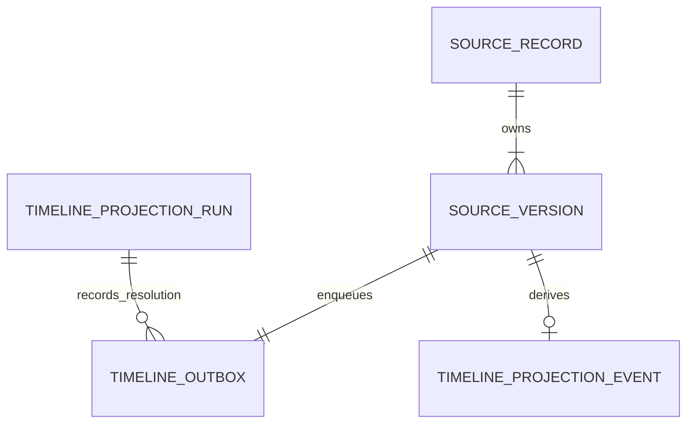

# P07-F02 architecture and operator guide

## Durable model and authority

Schema 52 adds three tables without rewriting authoritative clinical rows:

- `timeline_outbox`: one immutable source-version pointer per ledger ID, tenant/facility/patient/kind/version/contract and durable queued/applied/dead-letter/rebuilt lifecycle. No clinical snapshot payload or session secret is copied. Invalid pointer metadata retains sanitized diagnostic, attempts and the resolving run ID.
- `timeline_projection_events`: replaceable derived canonical event JSON, keyed by scoped event ID and unique scoped source ledger ID. Source facts remain in their original bounded context and immutable source_versions.
- `timeline_projection_runs`: immutable actor/patient/facility-scoped command-key hash and original nonclinical outcome. Same key/action/bound/coverage replays the recorded outcome; changed command semantics conflict.

AFTER INSERT source-version triggers cover the four F01 families. Source update, immutable history and queue pointer commit/rollback together, including partner corrections. Migration installs triggers and backfills valid retained versions atomically. The source ledger remains authoritative; these tables grant no new access.

## Consumer, ordering and rebuild

A synchronous local transaction processes at most 50 pointers. Canonical current-session authorization and source validation run before any work. It backfills missing permitted queue pointers idempotently, orders by source version/sequence and requires a materialized predecessor for amendments. Invalid contract or pointer metadata becomes a dead letter. Transient source/database failure does not advance work. The source-history bound remains 500 permitted versions per patient. No external network await occurs inside the database transaction.

Events use F01 deterministic identities and exact source-backed bytes. Duplicate delivery overwrites one derived event rather than appending duplicates. Already-materialized authorized events refresh historical badges from current canonical facts. Rebuild validates source first, atomically replaces only the caller's permitted families, records source-derived outcomes for covered pointers and retains original quarantine diagnostics/resolution evidence. Unrelated/unauthorized families are not deleted. Replaying/rebuilding twice produces the same event hash; run timestamps/IDs are excluded from the hash.

Transactions are the checkpoint: a killed process before COMMIT leaves no partial event, queue status or command receipt. Concurrent processes serialize via SQLite. A command receipt is not a promise that today's projection is still current; clients read status again after commands. Source updates can immediately make an earlier successful result stale.

## Authorization and read contract

`GET /api/clinical-timeline/projection?patient={id}` reauthorizes through F01, including per-source reads. It returns source/projection hash, projected/expected counts, pending work, sanitized dead letters and status. Cached clinical events are returned only when all permitted rows exactly match current canonical bytes and no unresolved scoped dead letter remains. Otherwise events=[] and status=stale. Tampering, gaps or revoked access never become silently fresh data. Existing canonical source view remains available independently.

`POST /api/clinical-timeline/projection` accepts `{patient, action: "process"|"rebuild", commandKey, limit?:1..50}`. Body is bounded to 2,000 UTF-8 bytes; unknown fields/query parameters and invalid JSON/types/bounds are rejected. Server supplies actor/purpose/organization/facility. Same-origin authenticated treatment/source-history permissions are required. Missing auth=401, role/purpose/origin=403, unavailable foreign patient=404, key collision=409, invalid=422, dependency/unknown failure=503. All responses are no-store/nosniff; no credentialed external CORS.

## Staff and operator procedure

Open a patient chart's Clinical timeline. Materialized timeline shows current/stale, matched hashes, queue counts and dead letters. Process next 50 versions advances a bounded page; Rebuild from source repairs the derived copy. Expand Preview materialized events only after current match. Exact source JSON links recheck access. Loading/error/cancel/refresh and phone containment are implemented; failed status fetch clears previews. The canonical timeline remains separately source-backed.

The shipped worker executes one bounded pass:

`npm run timeline:worker`

Supply CURASPHERE_TIMELINE_SESSION (existing original session), CURASPHERE_TIMELINE_PATIENT and a stable CURASPHERE_TIMELINE_COMMAND_KEY; preserve the four local synthetic sandbox flags. Foundation sessions are actually resolved against Foundation; local test sessions are checked in the source service. Do not print/store credentials in shell history or task reports. Worker prints only run/count/hash/status metadata. Session expiration/revocation or dependency downtime requires restoring valid authority and retrying the same key. Scheduling is explicit, not an implicit background daemon.

For dead letters, inspect the sanitized reason. A source-validated rebuild may supersede an invalid local pointer contract while retaining its diagnostic and resolving run ID. It does not apply the quarantined payload to source. Missing/corrupt source history requires authoritative recovery first; rebuild must fail closed until then. Do not edit source immutability constraints or lower permissions to clear an error.

## Recovery, retention and rollback

Stop worker invocation or remove the new UI/API route to disable derived processing. Retain source ledger, queue and run evidence; F01 source view continues. No operational down-migration deletes clinical or queue data. The exported destructive fixture rollback is exclusively for disposable isolated migration tests and is chained into older fixture helpers. Source/outbox coupling deliberately fails a source command if durable queue creation fails, rather than losing its event.

Inherited clinical retention/residency/access rules apply to derived event JSON; pointer and command evidence is retained for this local simulation. Genuine deployment requires qualified retention/privacy/architecture and clinical review. Operational monitoring for F02 uses scoped queue status, diagnostic and immutable run/audit records (`timeline.projection.process`, `.rebuild`, `.command`), without snapshot/value logs. Stream lag SLOs/alerting and Kafka adapters are later work. This implementation proves actual SQLite durability and worker contracts, not a Kafka outage simulation.

F03 filters/diffs, F04 advanced frontend and F05 projection-health features remain unstarted. Native mobile remains unchanged and is regression-tested against schema 52. Formal Phase 07 and qualified clinical/privacy/architecture/licensing acceptance remain pending. Production clinical functions stay disabled.
