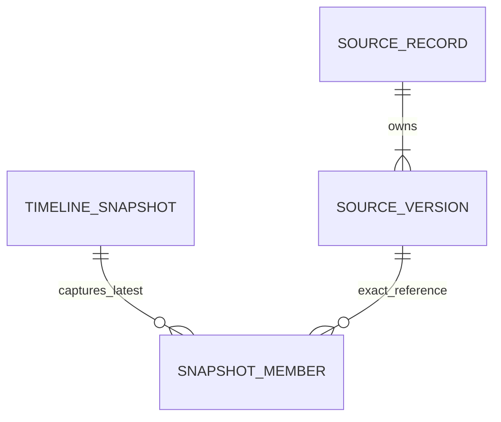

# P07-F03 architecture and operations

## Source authority and data model

Queries and comparisons use F01's current authorized canonical source history, not the derived F02 cache. No source clinical record is rewritten. Schema 53 adds immutable `timeline_snapshots` metadata and `timeline_snapshot_members` references (kind, record ID, exact ledger ID/version/SHA). Each snapshot stores a count and membership digest so missing/changed references fail closed. Members reference the existing immutable source ledger; no clinical values/narratives are copied into snapshot storage.

Snapshots are scoped to organization, facility, patient, actor and treatment purpose, with captured permission coverage. Their owner may reopen them under a new live authorized session. Removing coverage or losing referenced source evidence invalidates comparison. Capture keys replay the original baseline membership even after source changes; a different key captures a new baseline. Retain at most 100 snapshots per owner/patient/facility, each with at most 500 latest logical records. No automatic deletion of evidence is introduced. Destructive fixture rollback removes dependent metadata only in disposable migration tests.

## Query and chronology contract

`GET /api/clinical-timeline/query?patient={id}` supports:

| Parameter | Meaning |
| --- | --- |
| kind | all, condition, allergy, observation, medication-order |
| view | current (default: latest version per logical kind/record) or history (all explicitly labeled versions) |
| time | clinical (default) or recorded |
| from / to | Inclusive UTC calendar dates, YYYY-MM-DD |
| encounter | Exact encounter ID within already-authorized source events |
| direction | asc or desc (default) |
| limit | 1–50, default 25 |
| cursor | Opaque source/context-pinned continuation |

Return events, total, next, normalized filters, sourceHash and excludedUnknownTime. Unknown clinical times do not satisfy a clinical date filter. Without such bounds they remain visible and sort by recorded time as an explicit fallback. Date-only source dates match the literal calendar date at their declared precision, rather than being converted into an invented UTC instant. Stable timestamp/recorded-time/event-ID ties give reproducible pages. All operations retain the existing 500 authorized source-version bound; overflow fails rather than silently truncating.

The HMAC-SHA256 cursor contains only a version, opaque context hash and last event ID. It is domain-separated from the local signing root using `curasphere.timeline.cursor.v1`. Context pins actor/session/purpose/organization/facility/patient, canonical hash, permission coverage, normalized filters/page bound and baseline. No raw session or clinical values enter it. Explicit CURASPHERE_TIMELINE_KEY may override the existing CURASPHERE_INTEGRATION_KEY; both must be 32-byte hex roots. Missing keys fail closed when pagination is needed. Tamper=422; changed source/session/filter/coverage/baseline requires a 409 first-page restart. Live source authorization runs again before every page; a cursor is never a credential.

## Capture and comparison contract

- `POST /api/clinical-timeline/snapshots`: bounded 2,000-byte UTF-8 JSON `{patient, commandKey}`. Returns immutable owner-bound ID, captured time/hash and member count. Capture covers every permitted current record, independently of UI filters.
- `GET /api/clinical-timeline/snapshots?patient={id}`: up to 100 compatible own metadata records, without member facts.
- `GET /api/clinical-timeline/diff?patient={id}&baseline={snapshotId|last-visit}`: the same filters/page contract, with view=current only. Return one added or amended before→after entry per logical record. Every old/new pointer resolves through the existing authorized exact-version API.

Snapshot comparisons validate member count/digest and exact current-ledger references before computing changes. A correction is one amended record, not two contradictory current observations. New backdated records are added because membership is version-based, not inferred from clinical event time. Missing/corrupt/unauthorized baseline evidence is a restart conflict, not reassuring no-changes.

Last-visit mode additionally requires the existing encounter-read gate and scheduling dependency. It selects the latest completed authorized visit whose closure is not in the future. Recorded source times strictly earlier than closure establish the baseline. Matching closure timestamps cannot establish commit order, so affected records are boundary-uncertain with no definitive before member. New records/versions recorded later remain changes even if their clinical dates are old. No completed visit yields explicit no-prior-visit; it never asserts absence of clinical changes. Invalid/missing closure data or over-500 visit evidence fails closed. The selected encounter is reauthorized through its authoritative service.

## UX, security and operation

Open Clinical timeline → Filter events and compare snapshots. The separate explorer supports filter/reset, next/previous event and comparison pages, current/history badges, own baseline capture/list, since-visit mode and exact old/new source inspection. Comparison clears the earlier event list to avoid presenting stale v1 as current beside amended v2. Errors/conflicts clear source results and require explicit refresh; cancellation aborts pending fetch and clears views. No offline clinical cache or automatic retry is introduced. Patient-keyed components prevent cross-patient state reuse. Native mobile remains unchanged and is regression-checked against schema 53.

All API boundaries derive context from the live session, require same workspace origin and reuse F01 patient/source/history permissions. Strict query/body allowlists reject duplicates, unknown fields, malformed dates, bounds and cursors. Responses are no-store/nosniff. Source-correction POST now has the origin guard already used by source workflows; a foreign-origin request is denied before amendment. Audit actions timeline.query.read, timeline.diff.read, timeline.snapshot.capture/list store IDs/outcomes, not filter values, clinical snapshots or tokens.

For stale cursors, apply filters from page one; do not splice old/new pages. For missing signing root, restore the existing ignored local key without printing it or disabling validation. For snapshot quota, reuse a compatible baseline or request an actual retention review; do not delete ledger evidence to make a test pass. Source/scheduling outage requires service recovery before comparison. A corrupt snapshot/source reference requires authoritative recovery, not an assumed empty baseline. F02 worker can consume newly recorded source versions independently; its cache is never comparison authority.

Rollback disables the new explorer/query/snapshot routes and retains immutable source/snapshot evidence and the origin protection. F01/F02 contracts remain available. Operational rollback does not invoke destructive fixture helpers. Qualified retention/privacy/architecture/clinical/licensing review, real deployment/scheduling and production acceptance remain pending. F04/F05 are not implemented by this feature.
