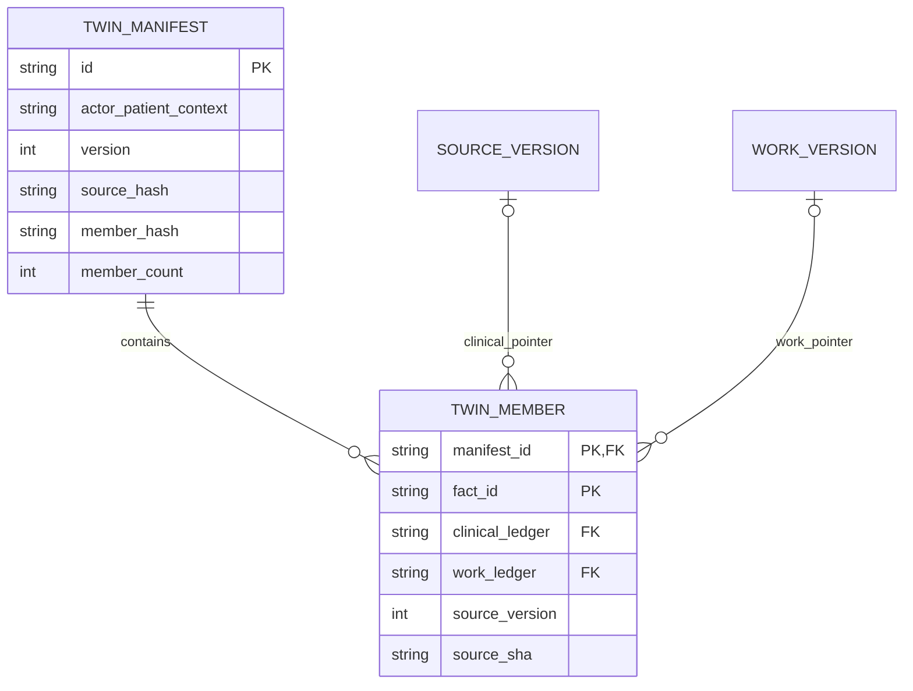
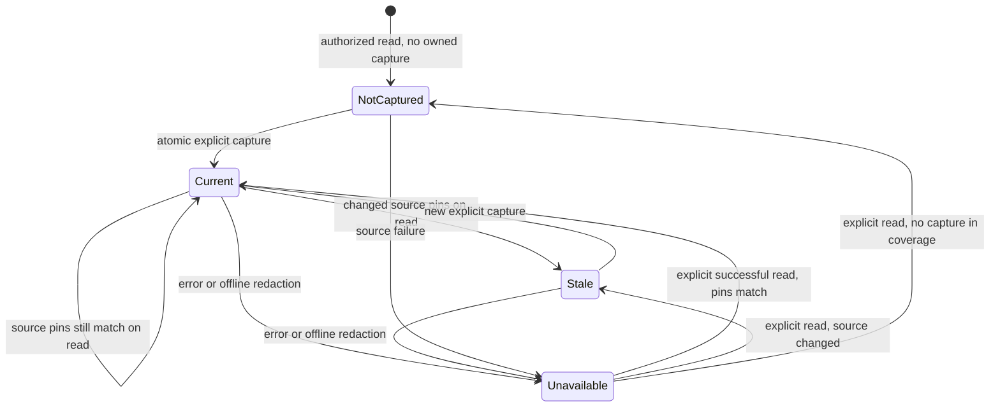

# P08-F01 architecture and operations

Local synthetic engineering only. Qualified clinical/privacy/architecture/licensing/prerequisite reviews and formal acceptance remain pending. Production clinical functionality remains disabled.

## Authority and representation

The legacy patient-state API and patient_state_builds contract are unchanged. The new Twin evidence contract uses separate schema-54 tables: twin_evidence_manifests and twin_evidence_members. A manifest pins current logical-record versions from authorized clinical history (condition, allergy assessment, observation, medication draft) and work-service history (order, care plan, originating-facility referral). It is a source-evidence representation, not an active-state clinical interpretation. Recorded status is retained literally. Draft medication is not an active therapy; cancelled work is not labeled pending. No inferred care gaps, diagnostic risk scores or clinical recommendations are generated. riskEvaluation is an unperformed policy marker with no patient signals, not a zero-risk finding.

Pending-work representation consists of versioned orders/plans/referrals, with their actual statuses. Mutable task rows are not fabricated into versioned assertions; existing task workflows remain unchanged. Clinical recency/active-state predicates belong to F02, disagreement handling to F03, refresh/rebuild machinery to F04 and advanced inspection UX to F05.

## Persistence and integrity

Manifests bind organization, facility, patient, actor, treatment purpose and exact source coverage. They have monotonically increasing actor/patient versions, immutable capture key, operational capture time, source/member digest and count. Members store only kind/record, exact source ledger foreign key, source version, raw-snapshot SHA, recorded time and deterministic fact ID. Exactly one clinical/work ledger FK must be set; member IDs and per-kind logical records are unique within a manifest. Four triggers prevent manifest/member updates/deletes.

Capture runs in one SQLite transaction; source reads, source hash, manifest and members commit together. Same scoped key replays original membership even after source changes; returned state then explicitly becomes stale with facts withheld. A key cannot be reused under changed purpose/coverage. Different keys create explicit new capture versions. Competing processes serialize; no source writes occur through Twin.

Limits: 500 permitted clinical source-history versions; 500 current work records and 500 cumulative work-history versions; at most 1,000 manifest members and 100 manifests per actor/patient across coverage contexts. The local limit retains evidence rather than deleting oldest captures. Production retention, subject-rights handling and capacity require qualified decisions. Metadata hashes are integrity/freshness indicators, not authorization capabilities.

Every read reauthorizes current clinical history and work-service rights. Work assertions require both the kind's read permission and work.history.read. The source-owned assertWorkHistoryAccess probe validates availability, both permissions and patient scope before querying, including when the portfolio is empty. An unavailable work service cannot become successful empty evidence. Existing workHistory authorizes history; it supports referral versions recorded at the receiving facility when the originating clinician remains an authorized party. Raw source selection is restricted to that authorized record/version/org and verified against history, never an arbitrary ledger supplied by the client. Loss of coverage hides old manifests; it does not leave formerly authorized facts visible. Historical work inspection also requires the logical work record to belong to the selected patient's currently authorized inventory. A cached manifest/digest is never patient authority, even if damaged membership is made internally self-consistent.

Member count and deterministic digest are checked before use. Fresh view facts come from exact current authorized immutable source snapshots, never copied fact values in storage. Source hash changes with any current pin/version/snapshot/recorded-time change. A stale manifest returns facts=[]; exact old-source inspection separately validates captured membership, current rights, ledger/version/hash/recorded-time and raw source integrity. History remains historical; it is not promoted to current.

## API contract

GET /api/patient-twin?patient={id} reads the latest owned capture for exact current coverage; manifest={id} selects an owned capture. Adding fact={64hex} requires manifest and returns only that pinned, reauthorized exact snapshot/pointer with historical=true/false. Unknown/duplicate query fields are invalid. Invalid IDs cannot select another source. No manifest means status=not-captured; an empty permitted source inventory can be explicitly captured without claiming absence of clinical problems.

POST /api/patient-twin accepts exactly {patient,commandKey} as bounded UTF-8 JSON (2,000 bytes), no query. The server supplies actor/organization/facility/purpose. It captures source evidence only; no clinical fields/status writes are accepted. Same-origin/live source authority and simulation gates apply; no credentialed external CORS. Responses are no-store/nosniff. Authentication=401; forbidden source purpose/role/origin=403; unavailable foreign/other-owner capture=404; changed-context key=409; malformed/bounds=422; source/database/integrity failure=503. Failures never return successful empty evidence. Existing audit receives twin.evidence.read/capture/inspect success/denied with IDs only, no source snapshots/values.

## Staff operation and UX

Patient chart links to /patients/{id}/twin. Refresh reads current evidence, Capture source evidence explicitly creates/replays a capture. Categories show source codes/displays/status/version/recorded time. Inspect evidence reauthorizes and displays actual structured values, optional exact JSON/provenance and explicit current/historical status. A newly historical inspected version clears old current assertion cards; Close restores its trigger or the refresh control. No source editing is offered.

Captured time and status refer to the last read, not a live feed. Refresh after source changes. Errors and offline/restored-page/context changes clear facts and source panels, abort requests and stop work. Reconnect requires explicit refresh. No clinical browser storage or capture replay queue is added. Cancel may leave an already committed capture; refresh before continuing. Empty coverage is explicitly not a normal-finding reassurance. Existing typography/cards, keyboard controls, responsive containment and source labels are reused. Native mobile Twin UI is not part of this schema feature; existing mobile functions are regression-tested.

## Migration, recovery and rollback

Schema 54 adds two tables/index/triggers without rewriting source or legacy PatientState rows. Failed DDL rolls back to schema 53; retry succeeds. Earlier disposable migration rollback helpers remove dependent Twin tables first; they must never be used operationally. Latest-schema test expectations move to 54 while older failure-boundary expectations remain unchanged.

For errors, restore actual source/work availability, live session and correct history rights, then refresh. For stale captures, inspect historical evidence if needed and explicitly capture new source versions. Never repair source corruption through Twin or weaken immutable-history guards. For quota, retain captures and obtain an approved retention decision; do not delete clinical evidence to make a test pass. Operational rollback disables the new page/API invocation while retaining tables and source evidence. No destructive down migration is required. P08-F02 remains unstarted.

## Schema and read-state diagrams

Exactly one clinical/work pointer is set per member. Source readers and the selected patient's authorized inventory remain authority; the stored digest alone grants no access.

Unavailable is a transient API/UI condition, not deletion of persisted evidence. Historic inspection is separately reauthorized; it does not make a stale capture current.
