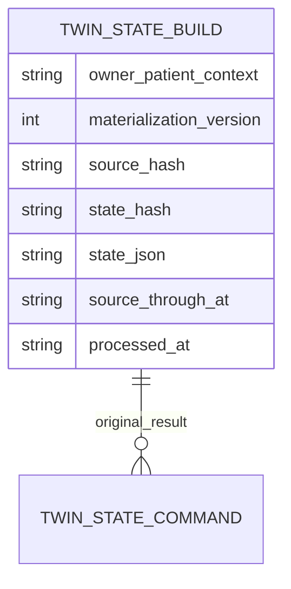

# P08-F02 deterministic projection and operations

Local synthetic use only. Formal Phase 08 remains NOT_STARTED; qualified reviews remain pending and production clinical functions remain disabled. F01 source evidence and legacy PatientState interfaces remain intact.

## Declared rules v1

The projector consumes F01's actual authorized inventory, including independent work-history rights, patient binding, bounded history and empty-source availability probes. Current immutable source version wins within a logical record. Separate source records are never merged by code.

- Problems are in the recorded-active section only when clinicalStatus is active and verification is confirmed/unconfirmed. Entered-in-error or unknown verification stays in other recorded assertions. Verification is retained and displayed; unconfirmed is not a confirmed diagnosis.
- Allergies remain source assessments; medication sources remain drafts. No active-therapy assessment is supplied by draft data. No care gaps, diagnostic risk score or recommendation is generated.
- Observation recency uses effectiveAt clinical instants, not recording time. Missing/non-instant times, unknown codes, unsupported statuses and clinical times later than that version's own recording time remain unprioritized. No clock-based aging into eligibility occurs. Eligible statuses are preliminary/final/corrected; their literal status remains visible.
- Group observations by exact source kind, supplied system/code-system/version/code/unit/coding metadata. Select maximum eligible clinical time within a group and retain all tied records. This means latest available per group, not a clinically approved age window. F04 max-age policy remains separate.
- Orders submitted/routed, plans active and referrals submitted/accepted are pending coordination assertions, not proof of unfinished clinical care. Closed statuses are explicitly kind-specific: cancelled orders; completed/cancelled plans; declined/cancelled referrals. Other statuses remain unclassified. Missing fields in a current work-version patch are not invented from mutable rows.
- Equal-time observation candidates and different recorded status/verification assertions produce deterministic structural ambiguity entries referencing every retained candidate. F03's clinical disagreement/escalation model remains separate; no structural match means no claim of clinical consistency.

Every fact retains exact source pointer and source fields. All input assertions remain in allFacts even when not selected into an active/recent/pending section. Source IDs link ambiguity entries to those facts. Stable array sorting and source bytes determine state and conflict hashes; processing clock/command ID/version are excluded.

## Durable model

Schema 55 adds immutable twin_state_builds and twin_state_commands, separate from F01 captures and the legacy patient_state_builds contract. Builds bind owner, tenant/facility/patient, treatment purpose and exact source coverage, schema=1/rules=twin-source-v1, monotonic materialization version, source/state hashes, derived JSON, source watermark and processed time. Commands bind the same owner scope/key to original build and request-context hash. Clinical values in this derived cache inherit source access/residency/retention restrictions; they are never authoritative.

Same-source/same-state rebuild reuses the original build/version/processedAt, with an additional immutable command receipt. New source/rules/state or a damaged derived copy creates an appended build. Replay of an old key returns its original build with current freshness re-evaluated; changed permission coverage/purpose cannot reuse that key. Limits are 100 builds and 200 commands per actor/patient. Retain evidence at the limit; do not delete records to hide an error. Production retention, erasure, capacity and clinical policy remain qualified work.

Source reads and build/receipt commit in one SQLite transaction. Failed command insertion rolls back the new build/version; competing processes serialize. No source writes, F01 capture-quota use or asynchronous jobs are introduced. Fixture rollback removes state commands/builds before dependent earlier rollback helpers; operational rollback retains evidence.

## Freshness and API

GET /api/patient-twin/projection?patient={id} reads the latest owned build for exact current source coverage. Optional build={twp_uuid} selects an owned build; fact={64hex} requires build and inspects an exact current source member. Unknown/duplicate query fields and malformed IDs reject. POST accepts exactly {patient,commandKey} as bounded UTF-8 JSON (2,000 bytes), no query; it rebuilds derived state only. Existing same-origin/live caller/source authorization and local simulation gates apply. All responses are no-store/nosniff. Codes: 401 authentication, 403 purpose/role/origin, 404 foreign/other-owner build or absent source, 409 stale source inspection or context-key collision, 422 invalid/bounds, 503 source/cache/database integrity failure.

Read reauthorizes the complete inventory and reproduces expected state before serving persisted facts. Current requires exact source hash, rules/schema, serialized state/hash and watermark. A recomputed forged cache hash does not bypass source comparison. Stale returns state=null; corrupt state fails unavailable. Explicit rebuild can append a source-validated repair; old evidence remains immutable. Exact source inspection requires current build, authorized selected-patient inventory membership and matching source SHA; stale projected inspection is 409. F01's separately authorized captured historical inspection remains available.

Response timestamps distinguish currentSourceThroughAt (maximum source recording time), build.sourceThroughAt, build.processedAt and checkedAt. Source-to-processing delay is processedAt minus watermark when valid/nonnegative. Outstanding lag uses oldest newly unprocessed source recording, with zero only when current and operational clock is coherent. Unknown change time, absent source time, future recording or future processing clock yields unknown where appropriate. These are recording-age/processing metadata, not Kafka offset lag, clinical event age or an approved SLO. Clinical dates never substitute for recording metadata.

IDs-only audit records twin.projection.read/rebuild/inspect success/denied. No source snapshots or measurements are logged. State JSON is served only after source reproduction, not trusted merely because it is persisted.

## Operator and staff procedure

The Patient Twin page shows Derived patient state above the preserved F01 evidence panel. Refresh reads; Rebuild patient state explicitly processes current authorized source. Inspect projected source shows exact JSON/provenance and restores focus when closed. Current/stale/not-built, processing/source times, outstanding lag, literal values/statuses, structural ambiguities and unprioritized count are visible. Empty sections explicitly avoid normal-finding reassurance. The page does not claim a live feed or automatically rebuild.

Offline/restored-page/context changes clear projected facts and source panels and abort requests. Reconnect requires explicit refresh; no commands are queued/replayed. Cancel may leave an already committed build: refresh before retry. Derived errors do not alter source/evidence records. Restore live source/history access and service availability before retry; use a new explicit rebuild key to repair corrupt derived state. Never skip authorization or edit source to make a build healthy.

To disable, stop invocation/remove the new panel/API entry while retaining builds, commands and source/evidence. No destructive operational down migration is needed. F03 clinical disagreement, F04 age/asynchronous refresh and F05 advanced/native UI are not started. Existing mobile is regression-tested; no new native state UI is claimed.

