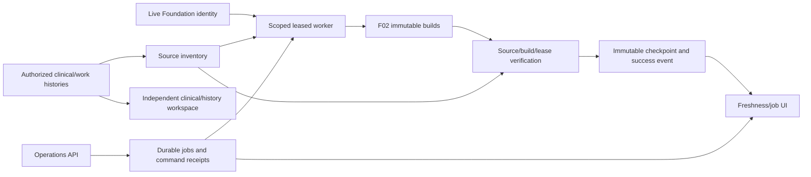
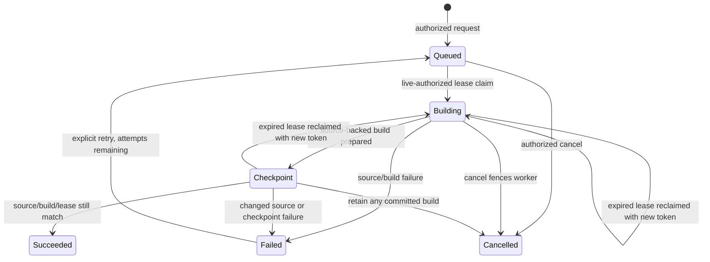

# P08-F04 architecture and operations

Local synthetic implementation. Formal Phase08 NOT_STARTED; qualified reviews pending, production clinical functions disabled. F05 unstarted.

## Data ownership and freshness

F02 source-owned inventory and deterministic state/rules remain authoritative for reproduction. Schema57 adds jobs, command receipts, immutable state/attempt events and immutable successful verification checkpoints. None contains copied clinical source values or a stored session credential. Job identity is immutable; state/attempt/lease/result progress is mutable only through live-authorized operations, validated against the last immutable event. Original builds and clinical sources are retained.

source-check-v1 budgets in seconds: condition3600, allergy3600, medication-order900, observation300, work:order300, work:plan900, work:referral300. These are local background source-verification budgets, not clinical expiry periods, validated clinical recency thresholds or production SLAs. A background checkpoint is distinct from F02 processedAt and live checkedAt. Same-source refresh reuses F02 bytes/version/processedAt but records a new background verification time. Source hashes, build integrity and exact context are checked before a checkpoint is used. New build/source without a matching checkpoint is unverified; deadline equality is overdue; future clocks are uncertain. Latest supplied observation clinical time and source-recording watermark are metadata, never inferred from refresh time. Empty coverage/portfolio never proves clinical absence.

## API and state machine

GET /api/patient-twin/operations?patient=ID returns sourceStatus, sourceHash, materialization metadata, lastBackgroundVerifiedAt, policyVersion, per-type count/budget/age/status/source watermark and observation clinical timestamp, needsRefresh, checkpointIntegrity and scoped jobs. No cached facts or worker lease token is returned. Every call obtains current source rights/availability; outages cannot become healthy empty results. Corrupt F02 cache is repair-required, without returning its values. Invalid checkpoint evidence cannot count as fresh and is superseded by append repair, never silently rewritten.

POST /api/patient-twin/operations accepts exactly patient, action, commandKey, plus job for retry/cancel. Actions refresh/repair enqueue durable work only; retry moves a failed job with fewer than three attempts back to queued; cancel fences queued/running work. Strict UTF-8 JSON2000-byte limit, unknown body keys and unknown/duplicate query checks, same-origin authentication, current actor/patient/facility/treatment/coverage, scoped idempotency and PHI-safe audit apply. Keys8–80 characters. One queued/running job per exact source context.100 jobs and200 receipts per actor/patient/facility; retain evidence at capacity. A key collision across action/job/coverage conflicts rather than mutating earlier work. Known replay is permitted at quota. Different readers own different F02 materializations/jobs; this is not a service-account impersonation path.

State sequence: queued -> running/building -> running/checkpoint -> succeeded/complete. Worker failure records source/building/checkpoint and a sanitized source-unavailable/source-changed/processing-failed/lease-expired code. Queued/running -> cancelled is explicit. Failed -> queued requires an explicit retry command and remaining attempt budget.60-second leases use opaque internal tokens and increment attempts. Expired lease can be reclaimed; a late or cancelled worker cannot certify success or overwrite a new lease. Three abandoned leases end as failed. Request receipt failure rolls back job/events; DDL failure rolls back schema57 while retaining schema56/source/state evidence.

## Real worker, partial progress and recovery

npm run twin:refresh:worker consumes at most one existing job for the supplied live owner/patient context. Supply CURASPHERE_TWIN_SESSION securely through process environment, CURASPHERE_TWIN_PATIENT and the existing authorized local synthetic environment; never put session credentials in command arguments, logs or files. Foundation identity is re-read on every process invocation, and all source/history permissions are rechecked at claim, prepare and completion. The lease/job metadata itself confers no authority.

The worker commits its claim, then prepares from current authorized sources. Rebuild uses the existing F02 idempotent append-repair service; healthy same-source refresh needs no new F02 command/build. Prepared result pointer and phase are persisted separately from successful verification. Completion again checks current source/build and lease before atomically inserting checkpoint and success event. A source correction between preparation/completion invalidates certification; retry incorporates current sources. Failed checkpoint can leave a valid derived build with failed refresh, never a success certificate. Retry reuses that progress. Authoritative source/history services do not depend on job state and no database transaction is held across asynchronous waiting. Cancellation does not erase already committed derived progress.

npm run twin:refresh:watch runs bounded sequential worker children every30 seconds for at most120 passes, stopping after three consecutive failed invocations. Each child has a60-second execution timeout and rechecks live identity. Default watch only processes explicitly queued work. Optional CURASPHERE_TWIN_AUTO_REFRESH=true evaluates due/background status, skips automatic scheduling on clock uncertainty and uses a stable policy/source/time-window command key to schedule due refreshes. It does not revive exhausted/failed jobs silently. The bounded watcher is a local simulation helper, not a production scheduler or capacity certification. Restart explicitly with renewed authority when stopped. Do not deploy or create external schedules without authorization.

## UX and observability

Freshness panel distinguishes source-match state, background verification age/budget and supplied observation clinical timestamps. Real queued/running/failed/succeeded/cancelled jobs, attempts, phase, time, result pointer and explicit retry/cancel actions are displayed. Source/history links remain actual authorized routes. Shared browser GET serialization avoids competing identity deadlines without caching authorization or queueing writes. On observed source-hash change or unavailable authority, all cached Twin panels are redacted and require explicit refresh. Optional job observation is read-only, ten-second intervals, at most20 checks; offline/context changes abort and stop observation. Reconnection never replays a command. HTTP cancellation may follow server commit; check durable jobs before retry.

Operational correlation is job ID plus immutable event IDs/attempt, source/build hashes and PHI-safe audit. Monitor queued age, running lease expiry, failed phase/code, attempts remaining, per-type overdue state and watcher exit/nonzero status. Local targets: claim on the next30-second watcher pass when authorized/available; finish within60-second lease for bounded source inventory; source/history available while waiting; no successful verification on failed checkpoint or changed source. These are engineering targets tested in simulation, not production SLO certification. Treat an expired lease/failure as actionable; restore source/identity/database dependencies then retry explicitly, or append repair for corrupt derived state. At retention quota, preserve/export evidence and obtain an approved retention decision.

Rollback: disable operations UI/route/watcher, retain new tables/checkpoints/jobs/builds and all sources. Disposable fixture rollback is for temporary test databases only. Restore altered immutable evidence from a trusted backup; never delete or forge it to make status green. F04 does not supply qualified clinical validation, new source families, active-medication assertions, diagnostic risk, clinical reconciliation, external reviewer delivery or F05 native/advanced UX.

## Dependency and state diagrams

